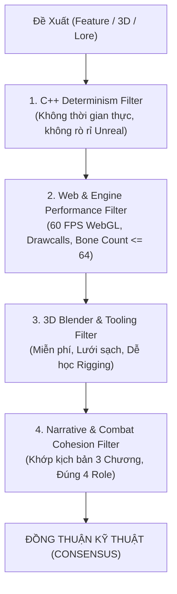

# MULTI-AGENT ARENA & DIALECTICAL DEBATE PROTOCOL
*Cơ chế Đấu trường Phản biện Đối thoại Chuyên sâu cho Hệ thống Multi-Agent*

---

## 1. NGUYÊN TẮC CHỐNG A DUA (ANTI-SYCOPHANCY RULE)

Các mô hình AI khi làm việc cùng nhau thường mắc phải lỗi **"Lịch sự giả tạo" (Polite Sycophancy)** — tức là bot này khen ngợi và đồng ý vô điều kiện với đề xuất của bot kia, dẫn đến việc các lỗi kiến trúc nghiêm trọng bị bỏ qua.

Trong **Multi-Agent Arena**:
* Mọi đề xuất kiến trúc, tính năng gameplay hoặc thiết kế 3D **BẮT BUỘC PHẢI BỊ RED-TEAM (MỔ XẺ RỦI RO)** bởi ít nhất 1 bot đối lập.
* Không được dùng các câu khen suông ("Tuyệt vời", "Ý tưởng rất hay").
* Bắt đầu phân tích ngay bằng:
  1. **Invariants Violated?** (Có phá vỡ bất biến kỹ thuật nào không?)
  2. **Performance & Memory Budget?** (Có làm tụt FPS Web hoặc tràn VRAM không?)
  3. **Learning & Ergonomics?** (Người dùng có học được gì từ cách làm này không, hay chỉ là bẫy công nghệ phức tạp?)

---

## 2. 4 TRỤ CỘT ĐÁNH GIÁ TRONG ĐẤU TRƯỜNG MATCHRPG

Mọi đề xuất (từ Orthex hoặc từ các bot nội bộ) đều được chấm điểm qua 4 bộ lọc:

1. **Trụ cột C++ Lõi (Deterministic Core):**
   * Luật chơi có nằm hoàn toàn trong `Core/` không?
   * Có phụ thuộc vào `FMath::RandRange` hay thời gian thực không? (Bắt buộc dùng `FMatchRng`).
   * Bộ test 744 assertions có vượt qua 100% không?
2. **Trụ cột Hiệu năng Web & Presentation:**
   * Diễn hoạt match-3 Three.js có giữ vững 60 FPS không?
   * Số lượng xương trên model có $\le 64$ để đảm bảo chạy mượt trên Web & Mobile không?
3. **Trụ cột Dựng hình 3D & Học tập Thực chiến:**
   * Có ép người dùng trả tiền cho các dịch vụ SaaS như Meshy Pro không? (Nếu có $\rightarrow$ Bác bỏ, chuyển sang Blender/Hunyuan3D/Mixamo miễn phí).
   * File sản phẩm có mở được bằng Blender để người dùng tự học hỏi cấu trúc xương và weight paint không?
4. **Trụ cột Cốt truyện & Gameplay:**
   * Kỹ năng có phục vụ cơ chế Stagger / Break / Ultimate Chain không?
   * Phong cách thị giác có đúng chuẩn Anime Cyberpunk hậu tận thế của *RE:FRAY* không?

---

## 3. CƠ CHẾ VÒNG LẶP (THE DEBATE LOOP)

Mỗi trận tranh luận gồm tối đa 3 hiệp:
* **Hiệp 1 (Thesis):** Đưa ra giải pháp ban đầu.
* **Hiệp 2 (Antithesis):** Phản biện chỉ ra ít nhất 2 rủi ro kỹ thuật và đưa ra phương án thay thế khả thi hơn.
* **Hiệp 3 (Synthesis / Consensus):** Tiếp thu phản biện, hoàn thiện phương án đạt chuẩn và chốt bản kế hoạch trình lên Bếp Trưởng (User).
