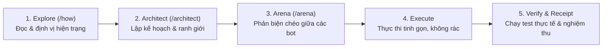

# PSTACK MICHELIN RIGOR & MULTI-AGENT PROTOCOL
*Lấy cảm hứng từ triết lý kỹ thuật của Lauren Tan (@poteto — cựu kỹ sư React Compiler Core Team, Meta, Cursor)*

---

## 1. MÔ HÌNH NHÀ BẾP MICHELIN (THE MICHELIN-STAR KITCHEN MODEL)

Trong mô hình của Lauren Tan:
* **Human User (Bạn) = Executive Chef & Game Director (Bếp Trưởng Điều Hành):**
  - Người nắm giữ tầm nhìn nghệ thuật, gu thẩm mỹ, và tiêu chuẩn nghiệm thu tối cao.
  - Không cần phải tự tay thái hành hay rửa chảo (không phải tự viết từng dòng boilerplate).
* **AI Coordinator (Antigravity) = Head Sous Chef (Bếp Phó Trưởng):**
  - Quản lý quy trình, phân chia đầu việc cho các trạm chuyên môn (Line Cooks / Subagents).
  - Nghiêm cấm đưa "món ăn sống" (code chưa test, thiết kế ảo tưởng) lên bàn của Bếp Trưởng.
* **Specialized Subagents = Line Cooks & Station Specialists:**
  - Mỗi bot phụ trách một trạm chuyên biệt: C++ Core, Three.js Web, Blender 3D Rigging, Lore Narrative.
  - Phải tuân thủ nghiêm ngặt ranh giới của trạm mình (Boundary Discipline).

---

## 2. NGUYÊN TẮC BẤT BIẾN: VERIFICATION-FIRST (CHỨNG MINH BẰNG KẾT QUẢ THỰC)

> **"The primary bottleneck of AI engineering is NOT generation, but verification."**
> — *Lauren Tan (@poteto)*

Mọi LLM đều có thể sinh ra hàng trăm dòng code trông rất thuyết phục chỉ trong 5 giây. Tuy nhiên, 90% lỗi phát sinh do sự thiếu kiểm chứng thực tế.

### Quy tắc "Receipts" (Phải Có Hóa Đơn Chứng Minh):
Tuyệt đối không một bot nào được tuyên bố "Đã xong" (Done) nếu không đưa ra **Bằng chứng thực thi cụ thể (Receipts)**:
1. **Kiểm thử Lõi C++:** Phải chạy `Tools/host_tests/build_and_run.bat` và báo cáo rõ:
   - Mã thoát (Exit code): `0`.
   - Kết quả: `checks: 744, failures: 0` (TAT CA TEST DEU DAT).
2. **Kiểm thử Web WASM:** Phải chạy `node Web/smoke_test.mjs` và báo cáo rõ:
   - Kết quả: `51 PASS / 0 FAIL`.
3. **Mỹ thuật 3D & Blender:** Phải có file `.blend` hoặc `.glb` thực tế, xác minh số lượng Polygon, cấu trúc Armature xương hợp lệ.

---

## 3. TRỊ BỆNH "AI SLOP" & SỬA TẬN GỐC (ROOT-CAUSE DISCIPLINE)

* **Không vá víu bề mặt (No Superficial Patches):** Khi gặp lỗi, không được dùng `try/catch` bọc ngoài để giấu lỗi, hoặc thêm các biến cờ tạm bợ. Phải tìm ra nguyên nhân gốc rễ (Root Cause) vì sao bất biến (invariant) bị vi phạm.
* **Tối giản độ tải đọc (Minimize Reader Load):** Không sinh ra các lớp bọc (wrapper) vô nghĩa. Code phải sạch, tường minh, có chú thích súc tích phục vụ cho việc học tập của Game Developer.
* **Ranh giới Lõi Lập Trình (Core Isolation):** Tuyệt đối không để rò rỉ mã phụ thuộc Engine (`UObject`, `AActor`, `FString`) vào thư mục `Source/MatchRPG/Public/Core/`.

---

## 4. QUY TRÌNH 5 BƯỚC THỰC THI (PLAYBOOK PIPELINE)

Mọi yêu cầu phức tạp từ người dùng phải đi qua 5 bước tuần tự:

1. **Explore (`/how`):** Chỉ đọc (Read-only), phân tích code/tài liệu hiện hữu, không vội sửa.
2. **Architect (`/architect`):** Lập phương án thiết kế rõ ràng, xác định rủi ro và chi phí tài nguyên.
3. **Arena (`/arena`):** Đưa phương án vào vòng phản biện chéo giữa các bot và Orthex để tìm lỗ hổng.
4. **Execute:** Viết mã hoặc tài liệu chuẩn chỉ, tuân thủ đúng phạm vi.
5. **Verify & Receipt:** Chạy test thực tế trên máy, kiểm tra runtime, cung cấp log chứng minh kết quả.
