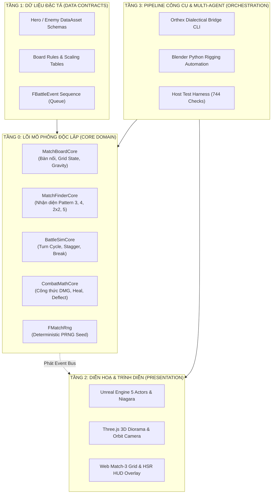
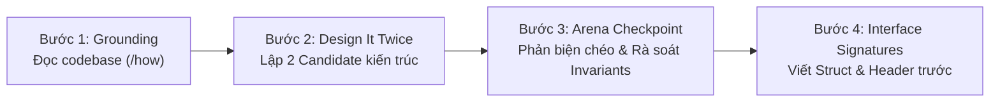

# PSTACK ARCHITECTURAL PARTITIONING & BOUNDARY PROTOCOL
*Chuẩn phân chia kiến trúc hệ thống của Lauren Tan (@poteto — Meta, Netflix, Cursor)*

---

## 1. MỤC ĐÍCH CỐT LÕI CỦA PSTACK TRONG PHÂN CHIA KIẾN TRÚC

Trong kỹ nghệ phần mềm của AI Agent, sai lầm phổ biến nhất là **nhảy thẳng vào viết code (jump-to-code)** khi chưa định hình cấu trúc. Hậu quả là code bị dính chặt vào nhau (tightly coupled), rò rỉ logic giữa các tầng và trở thành một "cục nợ công nghệ" (technical debt) không thể test hay tái sử dụng.

**`pstack` ra đời để giải quyết 3 bài toán phân chia kiến trúc:**
1. **Phân ranh giới rành mạch (Module & Layer Boundaries):** Tách bạch triệt để giữa *Lõi Nghiệp Vụ (Core Simulation)*, *Dữ Liệu (Data Assets)* và *Tầng Trình Diễn (Presentation / UI)*.
2. **Quy tắc "Design It Twice" (Bắt buộc thiết kế 2 phương án):** Nghiêm cấm chọn ngay phương án đầu tiên nảy ra. Phải phác thảo ít nhất 2 cấu trúc đối trọng (Candidate A vs Candidate B) rồi mới chọn hướng tối ưu.
3. **Định hình Chữ Ký Giao Diện Trước (Interface & Signature First):** Thiết kế Type, Struct, API signature và cách gọi hàm của Caller trước khi viết một dòng logic bên trong.

---

## 2. BẢN ĐỒ PHÂN CHIA KIẾN TRÚC MATCHRPG THEO PSTACK



### Các Bất Biến Ranh Giới (Architectural Invariants):
* **Bất biến 1 (Dependency Inversion):** Tầng 0 (`Core/`) **TUYỆT ĐỐI KHÔNG BIẾT GÌ** về Tầng 2 (`Unreal`, `Three.js`, `DOM`). Tầng Core không chứa bất kỳ `UObject`, `AActor`, `FString` hay thẻ HTML nào.
* **Bất biến 2 (Unidirectional Data Flow):** Tầng 2 (UI/Diễn hoạ) **KHÔNG ĐƯỢC TỰ TÍNH TOÁN SÁT THƯƠNG HOẶC MATCH-3**. UI chỉ là "bình hoa" nhận hàng đợi sự kiện (`FBattleEvent`) từ Core đẩy ra để phát animation tương ứng.
* **Bất biến 3 (100% Determinism):** Hai máy tính chạy cùng `(stage, roster, seed)` bắt buộc phải sinh ra kết quả trận đấu giống hệt nhau từng bit (Bit-exact replay).

---

## 3. QUY TRÌNH 4 BƯỚC PHÂN CHIA TÍNH NĂNG MỚI (/architect)

Khi người dùng hoặc Orthex đề xuất một tính năng mới (ví dụ: *Thêm trang bị Pet, Thêm hiệu ứng Đóng băng bàn nối, Thêm Mech Boss mới*):



### Bước 1: Grounding (Khảo sát thực địa)
* Đọc các file liên quan trong `Source/MatchRPG/Public/Core/` hoặc `Web/`.
* Xác định chính xác cấu trúc dữ liệu hiện tại đang lưu ở đâu (tránh tạo thêm bản copy dữ liệu trùng lặp).

### Bước 2: Design It Twice (Phác thảo 2 phương án đối trọng)
Luôn lập bảng so sánh giữa 2 hướng kiến trúc:
* **Candidate A (Monolithic / Direct):** Giải pháp tích hợp trực tiếp vào class hiện có. Đánh giá ưu điểm (nhanh, ít file) và nhược điểm (phình to class, khó mở rộng).
* **Candidate B (Decoupled / Modular Component):** Giải pháp tách riêng một module / handler độc lập. Đánh giá ưu điểm (sạch, dễ test cô lập) và chi phí kết nối (wiring cost).

### Bước 3: Arena Checkpoint (Rà soát rủi ro)
* Kiểm tra 4 câu hỏi tử huyệt:
  1. *Tính năng này có làm Lõi C++ mất tính deterministic không?*
  2. *Có làm Three.js Web bị lag dưới 60 FPS không?*
  3. *Có làm phát sinh chi phí SaaS trả phí vô lý không?*
  4. *Người dùng có học được nguyên lý kiến trúc sạch từ cách chia này không?*

### Bước 4: Interface & Signature First
Chỉ viết file Header định nghĩa Struct, Enum và Function Signature, kèm theo đoạn code mẫu mô tả cách Caller sẽ gọi API đó:
```cpp
// Ví dụ: Định nghĩa chữ ký trước khi viết logic thực thi
struct FPetSkillEffect {
    int32 ElementalColor;
    int32 ConvertedTiles;
    float StaggerMultiplier;
};

class IPetPassiveHandler {
public:
    virtual ~IPetPassiveHandler() = default;
    virtual void OnTurnEnd(const FBattleState& State, FMatchRng& Rng) = 0;
};
```
Sau khi kiến trúc và ranh giới đã được Bếp Trưởng (User) và Đấu trường đồng thuận, bot mới được phép bắt tay vào viết phần thân hàm (Implementation).
