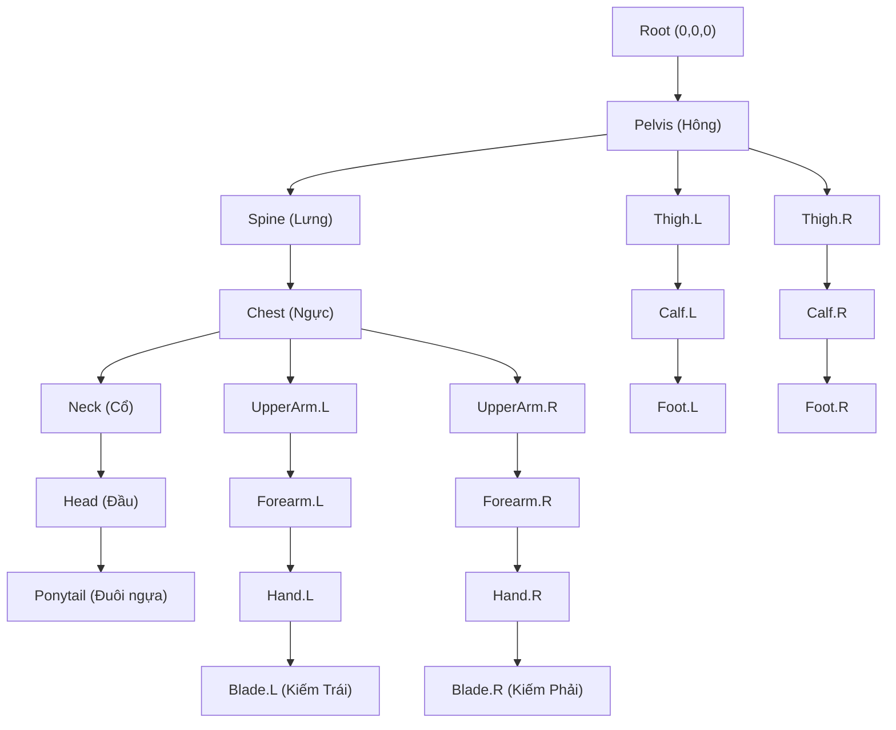

# Hướng Dẫn Thực Hành Blender 5.2: Tạo Nhân Vật Anime 3D Phong Cách PGR & Tự Khắc Phục Lỗi

Tài liệu này được biên soạn dành riêng cho dự án **MatchRPG**, đồng hành cùng model 3D mẫu **Astra (Striker - PGR Style)** đã được tạo sẵn trong thư mục dự án:
- **File dự án Blender**: [Astra_PGR_Model.blend](file:///d:/self/match-3-rpg/Content/Blender/Astra_PGR_Model.blend)
- **Hình ảnh render trực tiếp (EEVEE)**: [Astra_PGR_Preview_01.png](file:///d:/self/match-3-rpg/Content/Blender/Astra_PGR_Preview_01.png)
- **Script sinh model tự động**: [create_pgr_model.py](file:///d:/self/match-3-rpg/Tools/blender/create_pgr_model.py)

---

## 1. Tổng Quan Model 3D Astra (PGR Style)

Model được thiết kế dựa trên phong cách đặc trưng của tựa game **Punishing: Gray Raven (PGR)**:
- **Phong cách thị giác**: Anime Cyberpunk / Construct chiến đấu cơ động.
- **Tỷ lệ nhân vật**: Chiều cao ~1.72m, tỷ lệ 7 đầu cân đối, cằm chữ V nhọn, tóc nhọn vuốt về sau (High-tech Ponytail).
- **Trang phục**: Áo bó sát công nghệ cao (Techsuit), giáp ngực carbon (Chestplate), đai hông tiện ích gắn pin năng lượng, găng tay chiến thuật và bốt cao cổ bọc giáp gối.
- **Vũ khí**: Cặp song kiếm Plasma *Arc Edge* gắn liền trên hai tay, có lõi phát sáng điện tích Cyan.
- **Hệ thống diễn hoạt**: Tích hợp sẵn 2 Action Animation:
  1. `Action_Idle`: Nhịp thở tuần hoàn 60 frame (2 giây @ 30 FPS).
  2. `Action_Attack`: Chiêu chém song kiếm chữ X cực tốc (36 frame @ 30 FPS).

---

## 2. Bảng Phím Tắt Cốt Lõi Trong Blender 5.2

Khi mới bắt đầu với Blender, ghi nhớ các phím tắt sau sẽ giúp bạn thao tác nhanh gấp 10 lần:

### Chuyển đổi chế độ (Modes)
- `Tab`: Chuyển đổi qua lại giữa **Object Mode** (chọn đối tượng) và **Edit Mode** (chỉnh sửa lưới điểm/cạnh/mặt).
- `Ctrl + Tab`: Mở Pie Menu chuyển nhanh giữa: `Object Mode`, `Edit Mode`, `Pose Mode` (khi chọn Xương), và `Weight Paint Mode`.

### Điều hướng góc nhìn (Navigation)
- `Chuột giữa (MMB)`: Xoay góc nhìn 3D.
- `Shift + Chuột giữa`: Trượt góc nhìn (Pan).
- `Lăn chuột`: Thu phóng (Zoom).
- `Numpad 1`: Nhìn thẳng phía trước (Front View).
- `Numpad 3`: Nhìn bên hông (Side View).
- `Numpad 7`: Nhìn từ trên xuống (Top View).
- `Numpad 0`: Chuyển vào góc nhìn của Camera.
- `Phím ~` (dưới phím Esc): Mở Pie Menu góc nhìn nếu bàn phím không có Numpad.
- `Alt + Z`: Bật/Tắt chế độ xuyên thấu (X-Ray) để quét chọn được cả các đỉnh nằm ở mặt sau.

### Thao tác hình học cơ bản (Transform)
- `G` (Grab/Move): Di chuyển. Gõ thêm `X`, `Y` hoặc `Z` để khóa theo trục.
- `R` (Rotate): Xoay. Gõ `R` hai lần để xoay tự do kiểu cầu bi xoay (Trackball rotate).
- `S` (Scale): Phóng to / Thu nhỏ.
- `E` (Extrude): Đùn thêm thịt từ đỉnh, cạnh hoặc mặt.
- `I` (Inset): Thu nhỏ và lồng một mặt mới vào bên trong mặt hiện tại.
- `Ctrl + R`: Cắt vòng cạnh (Loop Cut). Lăn chuột để tăng số đường cắt.
- `M` (Merge): Nhập các điểm lại với nhau (At Center, At First, At Last, By Distance).
- `Ctrl + A`: **Áp dụng thông số (Apply Transforms)**. Đây là phím quan trọng nhất để tránh 90% lỗi mô hình!

---

## 3. Quy Trình Dựng Hình Nhân Vật Anime (PGR Modeling)

### Bước 1: Thiết lập Tỷ lệ & Box Modeling
1. Trong Object Mode, nhấn `Shift + A` ➔ **Mesh** ➔ **Cube**.
2. Thêm **Mirror Modifier** (Trục X) để mọi thao tác trên nửa thân trái tự động đồng bộ sang nửa thân phải. Tích chọn ô **Clipping** để các điểm ở giữa sống mũi/sống lưng không bị hở đôi.
3. Dùng `Ctrl + R` thêm 2 đường cắt ngang và 1 đường cắt dọc, dùng `G` kéo các đỉnh để tạo phom dáng cằm nhọn V-Line kiểu anime.
4. Hốc mắt anime không khoét cầu như người thật, mà là một bề mặt phẳng hơi nghiêng vào trong, tạo điểm tựa cho mảng mắt phát sáng 2D/3D.

### Bước 2: Dựng Tóc Anime (Hair Clumps)
Tóc anime phong cách PGR không dùng hệ thống tóc sợi (Particle Hair) mà dùng **Polygon Clumps** (từng khối tóc nhọn):
- **Cách 1 (Dùng Curve)**: Nhấn `Shift + A` ➔ **Curve** ➔ **Bezier**. Trong thẻ Curve Data ➔ Geometry ➔ Bevel, chọn một tiết diện hình tam giác hoặc thoi để tạo các lọn tóc nhọn mềm mại uốn lượn.
- **Cách 2 (Poly Extrude)**: Tạo một Plane nhỏ ở chân tóc, nhấn `E` đùn dài xuống trán và má, nhấn `S` thu nhỏ đỉnh ngọn tóc về 0.

### Bước 3: Dựng Trang Phục Techwear & Giáp Carbon
- Chọn các mặt trên cơ thể nhân vật tương ứng với phần giáp ngực, nhấn `Shift + D` để nhân bản, rồi nhấn `P` ➔ **Selection** để tách thành vật thể riêng.
- Nhấn `Alt + S` (Shrink/Fatten) để làm dày phần giáp phồng ra ngoài lớp áo 2-3mm.
- Thêm **Bevel Modifier** (Width: 0.005m, Segments: 2) để cạnh giáp có độ vát công nghiệp sắc sảo.

---

## 4. Thiết Lập Vật Liệu Cel-Shading NPR Chuẩn Anime Trong EEVEE

Phong cách PGR không dùng bóng đổ mềm kiểu tả thực (PBR) mà dùng kỹ thuật **NPR (Non-Photorealistic Rendering)** chia mảng sáng/tối sắc bén (2-Tone Shading).

### Cây Node Shading trong Shader Editor
Mở Workspace **Shading**, chọn vật liệu (ví dụ `M_Astra_Skin` hoặc `M_Astra_Armor`) và kết nối các Node như sau:

```
[ Diffuse BSDF ] (Color: White)
       │  BSDF
       ▼
[ Shader to RGB ]
       │  Color
       ▼
[ ColorRamp ] (Chế độ: CONSTANT)
   ├─ Vị trí 0.00: [ Màu Vùng Bóng Tối - Shadow Color ]
   └─ Vị trí 0.48: [ Màu Vùng Ánh Sáng - Base Color ]
       │  Color
       ▼
[ Material Output ] (Surface)
```

> [!TIP]
> - Đổi chế độ của **ColorRamp** từ `Linear` sang **`CONSTANT`**: Đây là bí quyết giúp tạo ra đường ranh giới ánh sáng cứng (Hard-edge shadow) đặc trưng của anime Nhật Bản!
> - Với các chi tiết đèn báo LED, mắt, hoặc lưỡi kiếm Plasma: Sử dụng Node **Emission** (Color: Cyan `#00D9FF`, Strength: `4.0` - `5.0`) để các chi tiết này tự phát quang rực rỡ trong đêm.

---

## 5. Kỹ Thuật Viền Mực Inverted Hull (Anime Outline)

Đây là kỹ thuật kinh điển được các tựa game như *Guilty Gear Strive*, *Genshin Impact*, và *Punishing: Gray Raven* sử dụng:

### Các bước thực hiện:
1. **Tạo vật liệu viền**:
   - Tạo vật liệu mới đặt tên là `M_Astra_Outline`.
   - Node Tree chỉ gồm Node **Emission** màu đen than chì (`#0A0A10`).
   - Trong thẻ **Material Properties** ➔ mục **Settings** ➔ Tích chọn ô **Backface Culling** (ẩn mặt lưng).
2. **Gán Modifier lên nhân vật**:
   - Chọn nhân vật, mở bảng **Modifier Properties** ➔ Thêm **Solidify**.
   - Cài đặt các thông số chính xác:
     - `Thickness`: `-0.006 m` (Số âm để bề mặt lộn ngược ra ngoài).
     - `Offset`: `1.0`.
     - `Material Offset`: Điền số thứ tự của slot chứa `M_Astra_Outline` (trong file mẫu là slot `6`).
     - Tích chọn ô **Flip Normals** (đảo ngược pháp tuyến).
     - Bỏ tích ô **Rim**.

Khi nhìn trong Viewport (ở chế độ Material Preview hoặc Rendered), nhân vật sẽ lập tức có một đường viền mực đen bao quanh hoàn hảo ở mọi góc quay camera!

---

## 6. Dựng Khung Xương (Armature) & Gắn Da (Rigging & Skinning)

### Cấu trúc bộ xương trong `Astra_PGR_Model.blend`:


### Quy tắc quan trọng khi dựng xương:
1. **Quy tắc đuôi tên `.L` và `.R`**:
   - Luôn đặt tên xương bên trái có hậu tố `.L` (ví dụ `Hand.L`) và bên phải là `.R` (ví dụ `Hand.R`).
   - Chỉ cần dựng xong nửa thân bên trái, bấm `Armature` ➔ `Symmetrize`, Blender sẽ tự tạo nửa bên phải hoàn hảo!
2. **Gắn da tự động (Automatic Weights)**:
   - Trong Object Mode: Chọn Mesh nhân vật trước ➔ giữ `Shift` chọn tiếp Khung xương (Armature).
   - Nhấn `Ctrl + P` ➔ Chọn **With Automatic Weights**.

---

## 7. Làm Diễn Hoạt (Action Animations) Trong Action Editor

File mẫu đã tích hợp sẵn 2 Action:
- `Action_Idle`: Tư thế đứng chiến đấu, hai tay cầm song kiếm, hông và ngực nhấp nhô nhịp thở tinh tế (60 frames).
- `Action_Attack`: Chiêu thức chém song kiếm chữ X lướt lên phía trước (36 frames).

### Cách xem và đổi giữa các Action:
1. Chọn Khung xương `Astra_Armature`.
2. Mở cửa sổ **Dope Sheet** (phía dưới màn hình), tại ô thả chọn chuyển từ `Dope Sheet` sang **Action Editor**.
3. Tại ô thả chọn tên Action ở giữa thanh công cụ, bạn có thể bấm chọn `Action_Idle` hoặc `Action_Attack`.
4. Nhấn **Phím Cách (Spacebar)** để chạy thử diễn hoạt trong thời gian thực!

> [!IMPORTANT]
> **Nút Khiên Bảo Vệ (Fake User / Shield Icon)**:
> Trong Blender, nếu một Action không được gán vào xương nào lúc bạn lưu file, Blender sẽ coi đó là dữ liệu thừa và **tự động xóa vĩnh viễn** khi tắt ứng dụng!
> Để bảo vệ Action của bạn, luôn bấm vào biểu tượng **Chiếc Khiên (Shield / Fake User)** bên cạnh tên Action để Blender luôn lưu trữ nó.

---

## 8. Sổ Tay Tự Sửa Lỗi Thường Gặp (Self-Repair & Troubleshooting)

Khi bạn tự tay chỉnh sửa hoặc mô hình hóa tiếp, hãy dùng bảng tra cứu nhanh này nếu gặp sự cố:

| Hiện tượng lỗi | Nguyên nhân | Cách khắc phục từng bước |
| :--- | :--- | :--- |
| **Mặt lưới bị đen thui hoặc có vệt bóng lồi lõm kì dị** | Pháp tuyến bề mặt (Normals) bị lộn ngược vào trong | Vào Edit Mode, nhấn `A` (chọn tất cả), nhấn `Alt + N` ➔ Chọn **Recalculate Outside** (hoặc nhấn `Shift + N`). |
| **Xoay hoặc phóng to xương bị méo mó, xiêu vẹo** | Tọa độ Scale của Mesh hoặc Armature khác `(1.0, 1.0, 1.0)` | Về Object Mode, chọn Mesh rồi nhấn `Ctrl + A` ➔ Chọn **Apply All Transforms**. Làm tương tự với Khung xương. |
| **Xoay xương cánh tay nhưng ngực hoặc chân bị kéo giãn theo** | Đỉnh bị dính nhầm trọng số vào Vertex Group của xương khác | Chọn Mesh ➔ Chuyển sang **Weight Paint Mode** (hoặc mở thẻ Vertex Groups), tìm tên xương bị kéo, dùng cọ vẽ chuyển trọng số (Weight) về `0.0` rồi quét qua vùng bị kéo dính. |
| **Không thấy màu bóng Anime Cel-Shading** | Đang ở chế độ xem Solid thô sơ | Nhấn giữ phím `Z`, rê chuột chọn **Material Preview** hoặc **Rendered** (góc trên bên phải 3D Viewport có 4 quả cầu tròn, chọn quả cầu số 3 hoặc 4). |
| **Đường viền mực Outline đen thui che kín toàn bộ nhân vật** | Chưa bật tính năng ẩn mặt lưng cho vật liệu viền | Chọn vật liệu `M_Astra_Outline`, trong thẻ **Material Properties** ➔ mục **Settings** ➔ tích chọn ô **Backface Culling**. |
| **Kiếm không di chuyển theo bàn tay** | Chưa gán đúng Vertex Group cho vũ khí | Vào Edit Mode, chọn toàn bộ các điểm của thanh kiếm, mở bảng **Vertex Groups**, chọn nhóm `Blade.L` (hoặc `Hand.L`), bấm nút **Assign** với Weight = `1.0`. |

---

## 9. Lộ Trình Mở Rộng Tiếp Theo

1. Bạn có thể mở trực tiếp file `Content/Blender/Astra_PGR_Model.blend` bằng Blender 5.2 để trải nghiệm, chỉnh sửa phom tóc hoặc thay đổi màu sắc vật liệu trong Shader Editor theo sở thích.
2. Nếu muốn xuất mô hình sang Engine Unreal hoặc Web:
   - Nhấn `File` ➔ `Export` ➔ **glTF 2.0 (.glb / .gltf)** (cho Web Three.js).
   - Nhấn `File` ➔ `Export` ➔ **FBX (.fbx)** (cho Unreal Engine 5). Tích chọn ô *Selected Objects*, chọn loại *Armature* và *Mesh*, trong thẻ Animation tích chọn *Bake Animation*.
