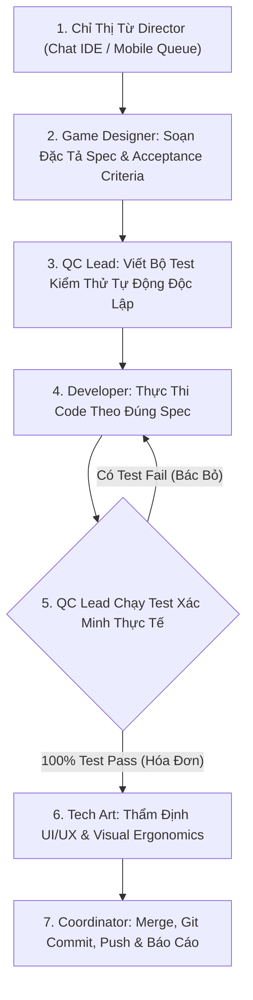

# MULTI-AGENT WORKFLOW SOP (STANDARD OPERATING PROCEDURE)
### Quy Chuẩn Cộng Tác Đa Agent Thực Chiến — Áp Dụng Cho MatchRPG & Các Dự Án Tương Lai
*Phiên bản:* **1.0.0** | *Tiêu chuẩn kiến trúc:* **Pstack Michelin Rigor (Lauren Tan)** | *Trạng thái:* **CHÍNH THỨC BAN HÀNH**

---

## 1. NGUYÊN TẮC CỐT LÕI (CORE TENETS)

> **"Không làm màu — Không log ảo — Phân vai độc lập — Chứng minh bằng kết quả thực tế."**

Khi xây dựng workflow đa tác tử (Multi-Agent System) để giải quyết các dự án phần mềm và game phức tạp, hai căn bệnh chết người thường gặp nhất là:
1. **Lịch sự giả tạo (Polite Sycophancy / A dua):** Các bot tự khen ngợi lẫn nhau, chấp nhận những đoạn code lỗi hoặc thiết kế viển vông mà không hề mổ xẻ rủi ro (Red-Teaming).
2. **Ảo tưởng tiến độ (Mock / Fake Slop):** Chạy các script tự sinh text nhật ký giả lập trong khi codebase thực tế đứng yên, không tiêu tốn token tư duy thực và không tạo ra giá trị sản phẩm.

Để workflow này thực sự có thể **tái sử dụng cho mọi dự án tương lai**, hệ thống thiết lập nguyên tắc **Bất Biến Ranh Giới (Boundary Discipline)**:

$$\boxed{\text{Designer ra Đề} \longrightarrow \text{QC viết Test} \longrightarrow \text{Dev viết Code} \longrightarrow \text{QC Nghiệm Thu} \longrightarrow \text{Coordinator Chốt}}$$

* **Mỗi người chỉ làm đúng chức trách duy nhất của mình**:
  - **Dev là Dev:** Không tự viết test chấm điểm cho chính mình, không tự suy diễn luật chơi ngoài bản đặc tả.
  - **QC là QC:** Độc lập với Dev, chỉ nhìn vào Spec của Designer để viết test hộp đen (Black-box Test), có quyền phủ quyết (Veto) bản build nếu có lỗi.
  - **Designer là Designer:** Thiết kế hệ thống, công thức toán học, bảng chỉ số và tiêu chuẩn nghiệm thu (Acceptance Criteria), không nhảy vào sửa code runtime.

---

## 2. MA TRẬN PHÂN QUYỀN & CHỨC NĂNG (RACI MATRIX)

| Vai Trò | Người Đảm Nhận | Nhiệm Vụ Cụ Thể (Được Làm) | Điều Cấm Kỵ (Tuyệt Đối Không Làm) |
| :--- | :--- | :--- | :--- |
| **Executive Director** | **Human User (Bạn)** | - Định hướng nghệ thuật, tầm nhìn gameplay, phê duyệt tính năng.<br>- Đưa ra chỉ thị tối cao qua Chat IDE hoặc Mobile Remote. | Không cần phải tự viết code boilerplate hay sửa lỗi chi tiết. |
| **Game Designer** | `@game_designer` | - Viết tài liệu đặc tả tính năng (`Specs/`).<br>- Định nghĩa công thức cân bằng, logic rẽ nhánh, bảng dữ liệu.<br>- Soạn thảo tiêu chuẩn nghiệm thu (`Acceptance Criteria`). | - KHÔNG viết code sản phẩm (`.cpp`, `.js`).<br>- KHÔNG tự ý suy diễn ngoài tầm nhìn của Director. |
| **Quality Control (QC)** | `@qc_lead` | - Viết bộ kiểm thử tự động độc lập (`test_*.mjs`, `test_*.cpp`).<br>- Bắt các trường hợp biên (Edge Cases), tràn số, rò rỉ bộ nhớ.<br>- Xuất Hóa Đơn Kiểm Thử (Receipts) với Exit Code 0. | - KHÔNG sửa code sản phẩm để "lách" cho test pass.<br>- KHÔNG duyệt bài khi chưa chạy test thực tế trên máy. |
| **Developer (Core / Web)** | `@cpp_core` & `@web_dev` | - Thực thi code sạch, chuẩn kiến trúc Pstack.<br>- Giữ vững tính tất định (100% Deterministic Core).<br>- Tối ưu hiệu năng 60 FPS, dung lượng bundle nhẹ, không memory leak. | - KHÔNG tự sửa test của QC.<br>- KHÔNG bỏ qua lỗi bằng `try/catch` rỗng.<br>- KHÔNG hardcode giá trị tuỳ tiện vào code. |
| **Tech Art & UI/UX** | `@tech_art` & `@uiux_lead` | - Kiểm soát công thái học chạm (Thumb Zone, min target 44px).<br>- Thẩm định mỹ thuật 3D, animation curves, ánh sáng, shaders.<br>- Triệt tiêu "AI visual slop" (mỏi mắt, méo phối cảnh). | - KHÔNG dùng các asset trả phí hoặc vi phạm bản quyền.<br>- KHÔNG để hiệu ứng thị giác che khuất tầm nhìn thao tác. |
| **AI Coordinator** | `@coordinator` (Antigravity) | - Tiếp nhận chỉ thị, phân rã công việc cho từng trạm.<br>- Giám sát handoff tuần tự giữa Designer $\rightarrow$ QC $\rightarrow$ Dev.<br>- Chạy tổng kiểm thử, commit Git, push origin, báo cáo minh bạch. | - KHÔNG báo cáo hoàn thành khi chưa có bằng chứng thực thi.<br>- KHÔNG sinh log ảo hay che giấu lỗi kỹ thuật. |

---

## 3. QUY TRÌNH THỰC THI 5 BƯỚC (THE 5-STEP PLAYBOOK)

Mọi tính năng mới hoặc yêu cầu sửa đổi từ người dùng bắt buộc phải đi qua chu trình khép kín sau:



### Bước 1: Tiếp Nhận & Phân Rã Chỉ Thị (Intake & Breakdown)
- **Đầu vào:** Chỉ thị từ Director qua chat IDE hoặc hàng đợi `Docs/discussions/MOBILE_COMMAND_QUEUE.json`.
- **Người thực hiện:** `@coordinator`.
- **Hành động:** Xác định phạm vi ảnh hưởng (Core Logic, 3D Rendering, UI, Math) và giao việc cho đúng trạm chuyên trách.

### Bước 2: Đặc Tả Hệ Thống (Spec & Acceptance Criteria)
- **Người thực hiện:** `@game_designer`.
- **Hành động:** Viết file đặc tả chi tiết. Mỗi tính năng bắt buộc có danh sách tiêu chuẩn nghiệm thu theo cấu trúc chuẩn:
  ```gherkin
  Given [Trạng thái ban đầu của bàn cờ / nhân vật]
  When  [Người chơi hoặc hệ thống thực hiện hành động]
  Then  [Kết quả chính xác về chỉ số máu, năng lượng, vị trí]
  ```
- **Ranh giới:** Không viết code.

### Bước 3: Kiểm Thử Độc Lập (Verification-First Test Authoring)
- **Người thực hiện:** `@qc_lead`.
- **Hành động:** Đọc `Acceptance Criteria` của Designer để viết file test (`test_*.mjs` hoặc file `.cpp` trong `Tools/host_tests/`).
- **Ranh giới:** Test được viết độc lập với quá trình code của Dev.

### Bước 4: Thực Thi Mã Nguồn (Pure Implementation)
- **Người thực hiện:** `@cpp_core` hoặc `@web_dev`.
- **Hành động:** Viết mã nguồn đáp ứng yêu cầu của Spec.
- **Ranh giới:** Không sửa đổi các file test của QC.

### Bước 5: Chạy Test Nghiệm Thu & Cung Cấp Hóa Đơn (Receipts)
- **Người thực hiện:** `@qc_lead` phối hợp `@coordinator`.
- **Hành động:** Chạy toàn bộ các bộ test tự động trên máy thực tế:
  * Lõi C++: `Tools/host_tests/build_and_run.bat` (Exit code: 0).
  * Web Logic: `node Web/test_*.mjs` (0 Failures).
- **Quyền phủ quyết:** Nếu có bất kỳ assertion nào thất bại, build bị từ chối ngay lập tức và gửi trả Dev sửa tận gốc rễ.

---

## 4. BỘ TEMPLATE MẪU CHO CÁC DỰ ÁN TƯƠNG LAI

### Template A: Phiếu Yêu Cầu Thiết Kế (Dành cho Game Designer)
```markdown
# [SPEC] TÊN TÍNH NĂNG
- Mục tiêu gameplay: [Giải quyết bài toán trải nghiệm gì?]
- Công thức toán học: [DMG = Base * (1 + Combo * 0.35)...]
- Trạng thái biên (Edge cases): [Khi HP = 0, khi bàn cờ không còn nước đi...]
- Acceptance Criteria (Tiêu chí nghiệm thu cho QC):
  1. Given A, When B, Then C.
  2. Given X, When Y, Then Z.
```

### Template B: Hóa Đơn Nghiệm Thu (Dành cho QC Lead & Coordinator)
```markdown
# [RECEIPT] BẰNG CHỨNG KIỂM THỬ THỰC TẾ
- Mã commit: [Hash Git]
- Môi trường chạy: [Local Windows / MSVC / Node.js]
- Kết quả chi tiết:
  * Suite 1: X/X PASS (0 FAIL)
  * Suite 2: Y/Y PASS (0 FAIL)
- Exit code: 0
- Xác nhận nghiệm thu: [Ký tên @qc_lead]
```

---

## 5. CAM KẾT VẬN HÀNH DỰ ÁN

1. **Triệt tiêu 100% Mock Logs:** Không cho phép bất kỳ script nào tự động sinh nhật ký thảo luận giả lập.
2. **Minh bạch hóa tiến độ:** Chỉ thị trên Mobile được lưu vào `MOBILE_COMMAND_QUEUE.json`, mọi thay đổi đều đi kèm Commit Git thật và Test thật.
3. **Quy chuẩn này là luật bất biến:** Áp dụng cho từng turn làm việc của AI trong dự án hiện tại và đóng gói làm tài liệu khung mẫu cho toàn bộ các dự án game/phần mềm tương lai.
