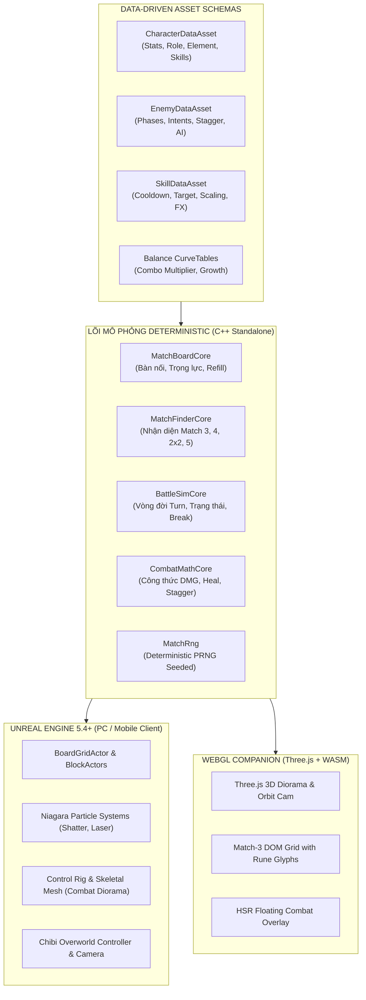
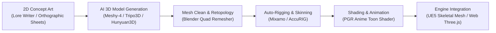

# RE:FRAY — PRODUCTION SYSTEM ARCHITECTURE & 3D ASSET PIPELINE BLUEPRINT
*Tài liệu Thiết Kế Kiến Trúc Hệ Thống & Quy Trình Tạo Dựng Asset 3D Chuyên Nghiệp cho Dự Án Chính Thức*

---

## 1. TỔNG QUAN KIẾN TRÚC HỆ THỐNG SẢN XUẤT (SYSTEM ARCHITECTURE)

Dự án RE:FRAY được kiến trúc hóa theo nguyên lý **Decoupled Deterministic Core** (Lõi Mô Phỏng Tách Biệt & Suy Diễn Xác Định). Đây là mô hình chuẩn công nghiệp được sử dụng bởi các studio hàng đầu để đảm bảo game có thể chạy mượt mà trên đa nền tảng (Unreal Engine 5.4+ trên PC/Console, WebGL/WASM trên trình duyệt web, và Mobile).



### Nguyên tắc Bất biến của Lõi (Core Engine):
1. **Không phụ thuộc Engine**: `Source/MatchRPG/Public/Core/` không chứa `UObject`, `AActor`, `CoreMinimal.h`. Mọi giao tiếp đi qua shim `MatchCoreCompat.h`.
2. **Deterministic Replay (100% tái lập)**: Toàn bộ trận đấu được xác định duy nhất từ `(stage, roster, seed)`. Không sử dụng thời gian thực hay hàm ngẫu nhiên của OS/Engine.
3. **Event Queue Sequencing**: Mọi biến động trạng thái (Match, Damage, Heal, Stagger, Break, Ultimate) được đẩy vào một hàng đợi sự kiện tuần tự (`FBattleEvent`), giúp tầng diễn hoạ (Presentation) phát animation mượt mà, đúng nhịp mà không làm lệch logic toán học.

---

## 2. QUY TRÌNH TẠO DỰNG ASSET 3D VỚI AI & DỤNG CỤ CHUYÊN DỤNG

Để sản xuất khối lượng lớn model nhân vật, trang phục, quái vật và mecha với chi phí tối ưu, dự án áp dụng quy trình **Hybrid Generative 3D Pipeline**:



---

## 3. SO SÁNH CÁC CÔNG CỤ TẠO DỰNG MODEL 3D CHUYÊN DỤNG

| Công cụ | Điểm mạnh | Hạn chế | Chi phí / Giấy phép | Khuyến nghị sử dụng |
| :--- | :--- | :--- | :--- | :--- |
| **Meshy.ai (Meshy-4)** | • Hỗ trợ cả **Text-to-3D** và **Image-to-3D**.<br>• Xuất PBR textures (Albedo, Normal, Roughness, Metalness).<br>• Tự động tạo xương (Auto-rigging).<br>• Có **REST API** tích hợp script tự động. | Cần ảnh orthographic sạch để tránh méo hình. | Freemium (Free credits hàng tháng; API trả phí theo token). | **Lựa chọn hàng đầu cho Production Pipeline tự động hóa.** |
| **Tripo3D (Tripo v2.5/3.0)** | • Tốc độ siêu tốc (preview nháp trong 10 giây).<br>• Rất xuất sắc với model phong cách Anime, Chibi và phụ kiện Mecha.<br>• Hỗ trợ tải file FBX có rig sẵn. | Textures chi tiết cận cảnh đôi khi hơi mềm. | Freemium (Miễn phí 10 model/tháng). | **Cực tốt cho Chibi Overworld Models & Minions.** |
| **Tencent Hunyuan3D 2.0** | • Mô hình mã nguồn mở thế hệ mới nhất của Tencent.<br>• Chất lượng hình học chi tiết cao, bake texture sắc nét.<br>• Chạy offline 100% trên máy có GPU NVIDIA (RTX 3060 trở lên). | Cần cấu hình máy tính cá nhân mạnh (VRAM ≥ 12GB). | **Miễn phí 100% (Open Source).** | **Giải pháp Free tối thượng khi không muốn tốn phí API.** |
| **TripoSR (Stability AI)** | • Mô hình nguồn mở chạy cực nhanh (0.5 giây / model).<br>• Chạy được trên cả GPU tầm trung (6-8GB VRAM). | Chỉ tạo mesh thô, độ phân giải texture thấp. | **Miễn phí 100% (MIT License).** | **Dùng làm Greybox 3D Blockout giai đoạn đầu.** |
| **Rodin Gen-1 (Hyper3D)** | • Tạo hình thể nhân vật người và tóc anime chi tiết số 1 hiện nay.<br>• Lưới Quad sạch gần như thợ làm tay. | Tốc độ xử lý lâu hơn (2-3 phút). | Có bản dùng thử có phí. | **Dùng cho các nhân vật chính 5-Sao (Hero SSR).** |

---

## 4. QUY TRÌNH PHỐI HỢP VỚI LORE WRITER BOT & TỰ THIẾT KẾ ẢNH

Để đưa ý tưởng từ **Lore Writer** thành Model 3D hoàn chỉnh, hãy tuân theo quy trình 3 bước:

### Bước 1: Trích xuất Concept Orthographic (Ảnh chiếu thẳng & cạnh)
Từ kịch bản của Lore Writer (ví dụ Astra, Sentinel Unit 07, Chimera Lửa):
- Yêu cầu xuất ảnh dạng: `Character Concept Sheet, T-Pose, Front View & Side View, neutral lighting, solid background, PGR cyberpunk style`.
- Loại bỏ các chi tiết bóng đổ phức tạp để AI 3D không bị nhầm lẫn giữa bóng tối và hoa văn khối.

### Bước 2: Đưa vào Image-to-3D (Meshy hoặc Hunyuan3D)
- Nạp ảnh Front View vào Meshy / Tripo3D.
- Thiết lập chế độ: `Topology: Quad`, `Polycount: High (30k - 50k tris)`, `PBR Textures: Yes`.
- Tạo mesh thô và thực hiện bước Refine để tạo độ sắc nét cho giáp mecha và vũ khí.

### Bước 3: Rigging và Animation trong 5 phút
- Tải file `.FBX` hoặc `.GLB` từ Meshy / Tripo.
- Nạp lên **Adobe Mixamo** (hoặc **AccuRIG** của Reallusion):
  - Chấm 5 điểm định vị (Cằm, 2 Cổ tay, 2 Đầu gối, Háng).
  - Tải về các bộ animation chuẩn: `Idle`, `Sword Slash (Attack)`, `Magic Cast (Skill)`, `Hit Reaction`, `Victory`.
- Nạp trực tiếp vào Unreal Engine 5 làm **Skeletal Mesh** hoặc đưa vào Web qua **Three.js GLTFLoader**.

---

## 5. HƯỚNG DẪN TỰ ĐỘNG HÓA VỚI MESHY API SCRIPT

Dự án đã được trang bị sẵn công cụ `Tools/pipeline/meshy_generate.py` để bạn có thể tạo model 3D tự động chỉ bằng một dòng lệnh terminal:

```bash
# Tạo model từ mô tả văn bản
py -3 Tools/pipeline/meshy_generate.py --prompt "Astra mecha anime swordswoman, high ponytail, cyber armor, T-pose" --output Content/3D/Astra_Meshy.glb

# Tạo model từ ảnh concept art 2D
py -3 Tools/pipeline/meshy_generate.py --image Content/Concepts/Astra_Front.png --output Content/3D/Astra_From_Concept.glb
```
