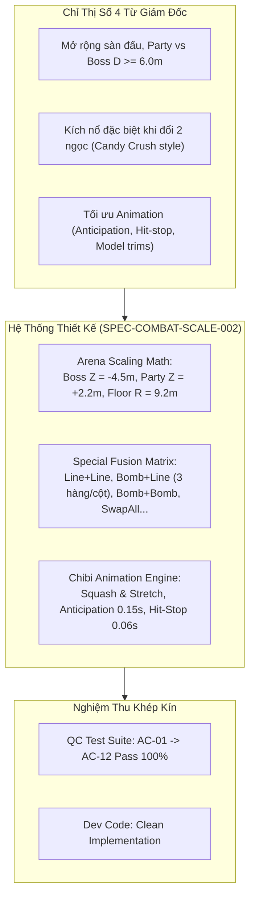
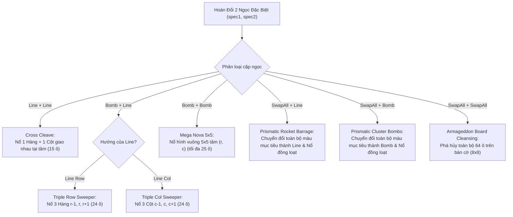

# [SPEC] MỞ RỘNG QUY MÔ SÀN ĐẤU & TỔ HỢP NGỌC ĐẶC BIỆT CANDY CRUSH STYLE
### Feature Specification: Arena Spatial Scaling, Special Gem Combo Fusion & Advanced Animation Engine
*Tài liệu đặc tả hệ thống Game Design theo quy chuẩn Docs/MULTI_AGENT_WORKFLOW_SOP.md*  
*Mã đặc tả:* **SPEC-COMBAT-SCALE-002** | *Phiên bản:* **1.0.0** | *Tác giả:* **Game Designer (`@game_designer`)**  
*Căn cứ kỹ thuật:* [chibi-character-animation](file:///d:/self/match-3-rpg/.agents/skills/chibi-character-animation/SKILL.md), [chibi-3d-character-design](file:///d:/self/match-3-rpg/.agents/skills/chibi-3d-character-design/SKILL.md), [cinematic-camera-director](file:///d:/self/match-3-rpg/.agents/skills/cinematic-camera-director/SKILL.md)  
*Đối tượng thụ hưởng:* **QC Lead (`@qc_lead`)**, **Developers (`@web_dev`, `@cpp_core`)**, **Tech Art Lead (`@tech_art`)**  
*Trạng thái:* **BAN HÀNH CHÍNH THỨC — CHUYỂN GIAO QC VIẾT TEST SUITE**

---

## 1. TỔNG QUAN & BỐI CẢNH CHỈ THỊ SỐ 4 (EXECUTIVE MANDATE #4)

Theo chỉ thị tối cao từ Executive Producer & Game Director qua Mobile Command Queue:
> *"Màn đấu quá nhỏ, cần tối ưu lại khoảng cách party vs quái quá gần, model có thể làm đẹp hơn k? Các block đặc biệt đổi chỗ cho nhau k trigger các effect đặc biệt như bom+ tên lửa sẽ kích nổ 3 hàng hoặc 3 cột tùy hướng tên lửa đc tạo ra (như candy crush) animation cũng cần đc tối ưu lại cho đàng hoàng, train lại animator với các skill animation"*

Bản đặc tả này thiết lập các chuẩn mực toán học, cơ chế logic Match-3 và nguyên lý diễn hoạt 3D mới để giải quyết dứt điểm 3 điểm nghẽn trải nghiệm:
1. **Không gian chiến trường chật chội (Cramped Arena):** Khoảng cách giữa Party và Boss trước đây chỉ đạt $3.1\text{m}$, khiến các nhân vật như đứng sát sạt Boss titan, làm mất cảm giác hoành tráng (Epic Scale) của thể loại RPG. Sàn đấu được mở rộng quy mô lớn, khoảng cách tác chiến đạt $D_{\text{combat}} \ge 6.0\text{m}$.
2. **Thiếu cơ chế tương tác hoán đổi Ngọc Đặc Biệt (Missing Special Gem Swapping Fusions):** Các khối ngọc Match-4 (Line), Match-5 (Bomb, SwapAll) khi đổi chỗ cho nhau hiện bị trơ lì hoặc chỉ đơn thuần đổi vị trí mà không nổ. Hệ thống được nâng cấp toàn diện theo cơ chế tương tác kinh điển của *Candy Crush*, bổ sung 6 tổ hợp dung hợp uy lực (Cross Cleave, 3-Row/3-Col Sweeper, 5x5 Mega Nova, Prismatic Chain...).
3. **Diễn hoạt thiếu lực và mô hình còn thô:** Bổ sung các pha lấy đà (Anticipation), lướt chém cự ly xa (Lunge Jump), dừng khung va đập (Hit-Stop $0.06\text{s}$) và viền phát quang vi mạch (Cyber Circuit Trims).



---

## 2. TÁI CẤU TRÚC KHÔNG GIAN CHIẾN TRƯỜNG & CÔNG THỨC TOÁN HỌC (ARENA SPATIAL SCALING)

### 2.1. Bất Biến Khoảng Cách Tác Chiến (Combat Distance Invariant)
> [!IMPORTANT]
> **Quy Tắc Bất Biến:** Khoảng cách Euclid theo trục nằm ngang giữa tâm đội hình Heroes $\vec{P}_{\text{party\_center}}$ và tâm khối Boss $\vec{P}_{\text{boss}}$ bắt buộc phải đạt tối thiểu $6.0\text{m}$:
> $$D_{\text{combat}} = \|\vec{P}_{\text{boss}} - \vec{P}_{\text{party\_center}}\| \ge 6.0\text{m}$$

* **Tọa độ Boss Mới:** Đẩy sâu về phía hậu cảnh:
  $$\vec{P}_{\text{boss}} = (0, 2.50, -4.50)$$
* **Tọa độ Đội Hình Party Mới ($Z_{\text{heroes}} = +2.20\text{m}$):**
  - **Astra (Attacker):** $\vec{P}_{\text{astra}} = (-3.20, 0.45, +1.90)$
  - **Elysia (Supporter):** $\vec{P}_{\text{elysia}} = (-1.10, 0.45, +2.30)$
  - **Lin (Healer):** $\vec{P}_{\text{lin}} = (+1.10, 0.45, +2.30)$
  - **Boran (Defender):** $\vec{P}_{\text{boran}} = (+3.20, 0.45, +1.90)$
  - **Tâm đội hình:** $\vec{P}_{\text{party\_center}} = (0, 0.45, +2.20)$

$$\implies D_{\text{combat}} = 2.20 - (-4.50) = 6.70\text{m} \quad (\text{Thỏa mãn } \ge 6.0\text{m})$$

### 2.2. Mở Rộng Kích Thước Sàn Đấu & Cột Tháp Cự Thạch (Arena Dimensions)
Để đảm bảo sàn đấu tương xứng với khoảng cách $6.70\text{m}$ và không tạo cảm giác các nhân vật đứng cheo leo sát mép vực:
* **Bệ Sàn Đấu Trụ Đa Tầng (Hex-Grid Arena Floor):**
  - Bán kính mặt sàn trên: $R_{\text{floor\_top}} = 9.20\text{m}$ (trước đây $5.4\text{m}$).
  - Bán kính đáy sàn dưới: $R_{\text{floor\_bot}} = 9.80\text{m}$.
  - Độ dày khối sàn: $H_{\text{floor}} = 0.60\text{m}$.
  - Vành đai Torus Neon bảo vệ: Bán kính lớn $R_{\text{torus}} = 9.25\text{m}$, ống bán kính $r = 0.12\text{m}$.
* **Vòng Xoay Năng Lượng Ngầm Đồng Tâm:**
  - Vòng lớn: Bán kính trong $5.50\text{m}$, bán kính ngoài $5.90\text{m}$, xoay $\omega_1 = +0.22\text{ rad/s}$.
  - Vòng nhỏ: Bán kính trong $3.20\text{m}$, bán kính ngoài $3.50\text{m}$, xoay $\omega_2 = -0.30\text{ rad/s}$.
* **4 Cột Tháp Cự Thạch Monoliths (Đẩy rộng ra 4 góc mới):**
  - Tây Bắc: $(-7.50, 1.80, -5.20)$
  - Đông Bắc: $(+7.50, 1.80, -5.20)$
  - Tây Nam: $(-8.20, 1.80, +3.20)$
  - Đông Nam: $(+8.20, 1.80, +3.20)$
  - Chiều cao cột: $4.50\text{m}$, Tinh thể bát diện lơ lửng tại $y = 4.80\text{m}$.

### 2.3. Tọa Độ Camera Mới & Vùng An Toàn Màn Hình Dọc (Portrait Framing)
Do khoảng cách sân đấu dãn rộng từ $3.1\text{m} \to 6.7\text{m}$, vị trí Camera được tái thiết lập để vừa bao trọn toàn bộ 4 Heroes và Boss Titan mà không bị bàn cờ Match-3 bên dưới che khuất:

| Chế độ Camera | Tọa độ $\vec{P}_{\text{cam}}$ | Điểm nhìn $\vec{P}_{\text{lookAt}}$ | Góc mở FOV | Mục đích |
| :--- | :--- | :--- | :--- | :--- |
| **Cơ bản (Base Idle)** | $(0, 7.80, 14.50)$ | $(0, 1.50, -0.80)$ | $42.0^\circ$ | Bao quát chuẩn Party tiền cảnh và Boss hậu cảnh. |
| **Giao tranh (Action Zoom)**| $(0, 9.80, 17.50)$ | $(0, 1.80, -1.20)$ | $48.0^\circ$ | Lùi xa mở rộng chiến trường khi có nổ ngọc, Skill. |
| **Cận cảnh Boss (Boss Focus)**| $(0, 4.20, 6.50)$ | $(0, 2.50, -4.50)$ | $38.0^\circ$ | Tự động lia máy ngắm Boss khi nhàn rỗi. |

---

## 3. QUY TẮC HOÁN ĐỔI NGỌC ĐẶC BIỆT CANDY CRUSH STYLE (SPECIAL GEM FUSION RULES)

### 3.1. Bất Biến Hoán Đổi Ngọc Đặc Biệt (Special Swap Invariant)
> [!IMPORTANT]
> **Quy Tắc Bất Biến Tuyệt Đối:** Mọi thao tác hoán đổi giữa 2 khối ngọc đặc biệt kề nhau (`specialGrid[r1][c1] !== NONE && specialGrid[r2][c2] !== NONE`) **KHÔNG BAO GIỜ** bị từ chối hoặc hoàn tác (`revert / swap_reject`), bất kể việc hoán đổi đó có tạo thành cụm 3 viên cùng màu truyền thống hay không.
> Hệ thống bắt buộc phải phát ra sự kiện `swap_accept` và kích hoạt ngay lập tức cơ chế nổ dung hợp tương ứng!

### 3.2. Ma Trận Tương Tác 6 Tổ Hợp Ngọc Đặc Biệt (The 6 Fusion Combinations)

```
[MA TRẬN DUNG HỢP NGỌC ĐẶC BIỆT CANDY CRUSH STYLE]
├── 1. LINE + LINE       : Song Tên Lửa -> Nổ Chữ Thập 1 Hàng + 1 Cột (Cross Cleave)
├── 2. BOMB + LINE       : Bom + Tên Lửa -> Quét Sạch 3 Hàng HOẶC 3 Cột (Mega Sweeper)
├── 3. BOMB + BOMB       : Song Bom Đại Pháo -> Nổ Diện Rộng 5x5 (Mega Nova Blast)
├── 4. SWAP_ALL + LINE   : Lỗ Đen + Tên Lửa -> Toàn bộ ngọc cùng màu biến thành Tên Lửa & Đồng loạt nổ
├── 5. SWAP_ALL + BOMB   : Lỗ Đen + Bom -> Toàn bộ ngọc cùng màu biến thành Bom & Đồng loạt nổ
└── 6. SWAP_ALL + SWAP_ALL: Song Lỗ Đen -> Quét Sạch Toàn Bộ 64 Ô Bàn Cờ (Armageddon Wipe)
```



### 3.3. Đặc Tả Chi Tiết Từng Tổ Hợp Kích Nổ

#### 1. Tổ hợp `LINE + LINE` (Song Tên Lửa — Cross Cleave)
* **Điều kiện:** Hoán đổi giữa 2 ngọc bất kỳ thuộc tập $\{ \text{LINE\_ROW}, \text{LINE\_COL} \}$.
* **Hành vi nổ:** Kích nổ đồng thời:
  - Toàn bộ hàng ngang $r_{\text{target}}$ (8 ô).
  - Toàn bộ cột dọc $c_{\text{target}}$ (8 ô).
* **Số ô bị tiêu diệt:** Đúng $W + H - 1 = 8 + 8 - 1 = 15$ ô.
* **Sát thương Combat:** Hệ số $\text{DamageMultiplier} = 2.0\times$, giảm Stagger Boss $15\%$.
* **Hiệu ứng VFX:** 2 luồng sóng xung kích ánh sáng laser chém ngang và chém dọc xé toạc bàn cờ.

#### 2. Tổ hợp `BOMB + LINE` (Bom + Tên Lửa — Candy Crush Mega Sweeper)
* **Điều kiện:** Hoán đổi giữa $1 \times \text{BOMB\_3X3}$ và $1 \times (\text{LINE\_ROW} \lor \text{LINE\_COL})$.
* **Hành vi nổ (Phụ thuộc vào hướng của viên Line tham gia hoán đổi):**
  * **Trường hợp A — Nếu là `LINE_ROW` (Tên lửa ngang):**
    Quét sạch liên tiếp **3 Hàng Ngang** song song:
    $$\text{Rows} = \{ r - 1, \; r, \; r + 1 \} \cap [0, \; H - 1]$$
    Tổng số ô nổ: $3 \times 8 = 24$ ô (ở giữa bàn) hoặc $2 \times 8 = 16$ ô (ở mép biên).
  * **Trường hợp B — Nếu là `LINE_COL` (Tên lửa dọc):**
    Quét sạch liên tiếp **3 Cột Dọc** song song:
    $$\text{Cols} = \{ c - 1, \; c, \; c + 1 \} \cap [0, \; W - 1]$$
    Tổng số ô nổ: $3 \times 8 = 24$ ô (ở giữa bàn) hoặc $2 \times 8 = 16$ ô (ở mép biên).
* **Sát thương Combat:** Hệ số $\text{DamageMultiplier} = 3.5\times$, giảm Stagger Boss $25\%$.
* **Hiệu ứng VFX:** Quả đại bác nạp năng lượng phóng ra 3 đầu đạn tên lửa khổng lồ quét song song càn quét chiến trường.

#### 3. Tổ hợp `BOMB + BOMB` (Song Bom Đại Pháo — Mega Nova 5x5)
* **Điều kiện:** Hoán đổi giữa $2 \times \text{BOMB\_3X3}$.
* **Hành vi nổ:** Kích nổ toàn bộ vùng hình vuông kích thước $5 \times 5$ ô có tâm đặt tại vị trí hoán đổi:
  $$\text{Tiles} = \{ (i, j) \mid \max(0, r-2) \le i \le \min(H-1, r+2), \; \max(0, c-2) \le j \le \min(W-1, c+2) \}$$
* **Số ô bị tiêu diệt:** Lên tới 25 ô trên bàn cờ.
* **Sát thương Combat:** Hệ số $\text{DamageMultiplier} = 4.0\times$, phá hủy toàn bộ chướng ngại vật (Rock, Ice, Crate, Chain) trong phạm vi.

#### 4. Tổ hợp `SWAP_ALL + LINE` (Ngũ Sắc Dung Hợp Tên Lửa — Prismatic Rocket Barrage)
* **Điều kiện:** Hoán đổi giữa $1 \times \text{SWAP\_ALL}$ và $1 \times (\text{LINE\_ROW} \lor \text{LINE\_COL})$.
* **Hành vi nổ:**
  1. Xác định màu mục tiêu $C_{\text{target}}$: Là màu của viên Line tham gia hoán đổi (hoặc màu phổ biến nhất).
  2. Toàn bộ các viên ngọc mang màu $C_{\text{target}}$ trên khắp bàn cờ lập tức **chuyển hóa thành ngọc Line** (hướng ngẫu nhiên hoặc cùng hướng).
  3. Tất cả các viên Line vừa tạo **đồng loạt kích nổ dây chuyền**, tạo ra cơn bão tia laser đan chéo toàn màn hình!
* **Sát thương Combat:** Hệ số $\text{DamageMultiplier} = 5.0\times$, Boss bị choáng nhẹ $0.5\text{s}$.

#### 5. Tổ hợp `SWAP_ALL + BOMB` (Ngũ Sắc Dung Hợp Bom — Prismatic Cluster Bombs)
* **Điều kiện:** Hoán đổi giữa $1 \times \text{SWAP\_ALL}$ và $1 \times \text{BOMB\_3X3}$.
* **Hành vi nổ:**
  1. Xác định màu mục tiêu $C_{\text{target}}$ từ viên Bom.
  2. Toàn bộ các viên ngọc mang màu $C_{\text{target}}$ trên bàn cờ biến thành các quả bom `BOMB_3X3`.
  3. Toàn bộ các quả bom nổ tung liên hoàn, xóa sạch phần lớn bàn cờ.
* **Sát thương Combat:** Hệ số $\text{DamageMultiplier} = 6.0\times$.

#### 6. Tổ hợp `SWAP_ALL + SWAP_ALL` (Song Lỗ Đen — Armageddon Board Cleansing)
* **Điều kiện:** Hoán đổi giữa $2 \times \text{SWAP\_ALL}$.
* **Hành vi nổ:** **Quét sạch toàn bộ 64 ô** ($8 \times 8$) của bàn cờ. Mọi khối ngọc và chướng ngại vật đều bị hút vào hố đen hư vô.
* **Sát thương Combat:** Hệ số tối thượng $\text{DamageMultiplier} = 10.0\times$, lập tức Break vỡ vụn toàn bộ khiên Stagger của Boss, kích hoạt trạng thái choáng váng hoa mắt $720^\circ$ của Boss.

---

## 4. NGUYÊN LÝ DIỄN HOẠT CHIBI NÂNG CAO & CHI TIẾT HÓA MÔ HÌNH (ANIMATION & MODEL ENGINE)

Kế thừa trực tiếp từ quy chuẩn [chibi-character-animation](file:///d:/self/match-3-rpg/.agents/skills/chibi-character-animation/SKILL.md), hệ thống hoạt ảnh được nâng cấp chuẩn 6 pha:

### 4.1. Công Thức Biến Dạng Squash & Stretch (Bảo Toàn Thể Tích)
Khi di chuyển với khoảng cách tác chiến mới $D_{\text{combat}} = 6.70\text{m}$, nhân vật cần biến dạng co giãn thể tích rõ rệt để tạo cảm giác tốc độ anime:

$$S_x(t) \cdot S_y(t) \cdot S_z(t) \approx 1.0$$

* **Pha Anticipation (Lấy đà 0.15s):** Hạ trọng tâm, nén dọc:
  $$S_y = 0.85, \quad S_x = S_z = 1.08, \quad \Delta Y = -0.08\text{m}, \quad \Delta Z = +0.15\text{m}$$
* **Pha Lunge Slash (Phóng lao chém 0.45s):** Kéo giãn dọc trục di chuyển:
  $$S_y = 1.25, \quad S_x = S_z = 0.89, \quad \Delta Z_{\text{lunge}} = -3.20\text{m} \to -4.00\text{m}$$
  Hero lướt qua quãng đường hơn $3.5\text{m}$ áp sát Boss, chém một đường vệt kiếm sáng rực (Slash Trail Arc) rồi bật nảy trở về vị trí cũ theo hàm dao động tắt dần.

### 4.2. Cơ Chế Dừng Khung Va Đập (Hit-Stop Micro-Pause)
Ngay tại thời điểm vũ khí chạm vào thân Boss hoặc khi quả bom nổ tung:
* **Thời lượng Hit-Stop:** Toàn bộ chuyển động của Hero và Boss **đóng băng trong đúng $0.06\text{s}$ (3-4 frames tại 60 FPS)**.
* **Visual Impact:** Màn hình chớp nhẹ viền trắng bạc (`VFX Trauma Flash`), tạo cảm giác vũ khí "chém ngập vào giáp thép" trước khi nổ tung hiệu ứng số sát thương.

### 4.3. Nâng Cấp Chi Tiết Mô Hình Chibi Anime (Model Detailing & Articulated Pivots)
1. **Khớp Chuyển Động Độc Lập (Articulated Pivots):**
   - Tách rời cụm đầu (`headMesh`), cụm thân (`bodyGroup`), cánh tay cầm vũ khí (`weaponArmGroup`).
   - Cho phép đầu xoay độc lập bù góc Camera trong khi thân lao về phía Boss.
2. **Đường Viền Vi Mạch Phát Quang (Cyber Circuit Trims):**
   - Ốp các dải viền Neon mỏng ($0.02\text{m}$) dọc sống lưng áo giáp và viền bốt của 4 Heroes.
   - Vật liệu: `MeshStandardMaterial` với `emissiveIntensity = 1.35`, tạo điểm nhấn sắc nét không bị bệt màu trên nền tối.

---

## 5. BẢNG TIÊU CHUẨN NGHIỆM THU ĐỘC LẬP CHO QC (ACCEPTANCE CRITERIA)

Toàn bộ 12 tiêu chí nghiệm thu dưới đây được biên soạn theo chuẩn **Given / When / Then** để QC Lead (`@qc_lead`) viết bộ test tự động độc lập `Web/test_arena_scale_and_combos.mjs`:

### Nhóm AC 1: Quy Mô Sàn Đấu & Bất Biến Khoảng Cách Tác Chiến
* **AC-01 (Combat Distance Invariant):**
  * **Given:** Bàn đấu 3D Diorama được khởi tạo hoàn tất.
  * **When:** Đo đạc khoảng cách giữa tâm đội hình Heroes $\vec{P}_{\text{party\_center}}$ và vị trí Boss $\vec{P}_{\text{boss}}$.
  * **Then:** Khoảng cách Euclid $D_{\text{combat}} = \|\vec{P}_{\text{boss}} - \vec{P}_{\text{party\_center}}\|$ bắt buộc phải đạt $\ge 6.0\text{m}$ (Giá trị chuẩn: $6.70\text{m} \pm 0.2\text{m}$).
* **AC-02 (Arena Floor Geometry Scale):**
  * **Given:** Sàn đấu `diorama.stageGroup` được render trong Three.js.
  * **When:** Kiểm tra bán kính mặt sàn `floorGeo.parameters.radiusTop`.
  * **Then:** Bán kính phải đạt tối thiểu $8.5\text{m}$ (Chuẩn: $9.20\text{m}$), và khoảng cách 4 cột tháp cự thạch Monoliths đến tâm đấu trường phải $\ge 7.0\text{m}$.
* **AC-03 (Camera Portrait Safe Framing):**
  * **Given:** Camera ở chế độ quan sát cơ sở (Base Idle).
  * **When:** Kiểm tra tọa độ `engine.camera.position` và góc mở `FOV`.
  * **Then:** Tọa độ $Z_{\text{cam}} \ge 13.5\text{m}$ (Chuẩn: $14.5\text{m}$), $Y_{\text{cam}} \ge 7.0\text{m}$, và tất cả 4 Heroes cùng Boss đều nằm trọn vẹn trong Frustum của Camera (không bị clipping hay che khuất).

### Nhóm AC 2: Bất Biến Hoán Đổi Ngọc Đặc Biệt (Candy Crush Fusions)
* **AC-04 (Special Swap Revert Prohibition):**
  * **Given:** Hai ô kề nhau $(r_1, c_1)$ và $(r_2, c_2)$ đều chứa ngọc đặc biệt (`specialGrid !== NONE`).
  * **When:** Gọi hàm `gameState.swap(r1, c1, r2, c2)`.
  * **Then:** Hàm bắt buộc phải trả về `true`, phát ra sự kiện `swap_accept`, và **TUYỆT ĐỐI KHÔNG** phát ra sự kiện `swap_reject` hay hoàn tác vị trí (`revert`).
* **AC-05 (Line + Line Cross Explosion):**
  * **Given:** Ô $(r, c)$ hoán đổi giữa 2 ngọc thuộc tập $\{\text{LINE\_ROW}, \text{LINE\_COL}\}$.
  * **When:** Kích hoạt nổ dung hợp.
  * **Then:** Toàn bộ hàng ngang $r$ (8 ô) và cột dọc $c$ (8 ô) bị dọn sạch; tổng số ô bị tiêu diệt chính xác bằng 15 ô; hệ số sát thương đạt $\ge 2.0\times$.
* **AC-06 (Bomb + Line Triple Sweeper):**
  * **Given:** Hoán đổi giữa $1 \times \text{BOMB\_3X3}$ và $1 \times \text{LINE\_ROW}$ tại ô $(r, c)$ (với $1 \le r \le 6$).
  * **When:** Kích hoạt nổ dung hợp.
  * **Then:** Quét sạch liên tiếp đúng 3 hàng ngang: $r-1, r, r+1$ (tổng cộng $3 \times 8 = 24$ ô bị phá hủy).
  * *(Trường hợp hoán đổi với `LINE_COL`):* Quét sạch liên tiếp đúng 3 cột dọc: $c-1, c, c+1$ (tổng cộng 24 ô bị phá hủy).
* **AC-07 (Bomb + Bomb 5x5 Mega Nova):**
  * **Given:** Hoán đổi giữa 2 ngọc $\text{BOMB\_3X3}$ tại ô trung tâm $(r, c)$ (với $2 \le r, c \le 5$).
  * **When:** Kích hoạt nổ dung hợp.
  * **Then:** Toàn bộ vùng hình vuông $5 \times 5$ (đúng 25 ô) xung quanh tâm bị kích nổ và xóa sạch; mọi chướng ngại vật trong vùng đều bị tiêu diệt.
* **AC-08 (SwapAll + Line Prismatic Rocket Barrage):**
  * **Given:** Bàn cờ chứa $1 \times \text{SWAP\_ALL}$ và $1 \times \text{LINE}$ kề nhau, cùng với ít nhất 6 viên ngọc thường có màu $C_{\text{target}}$.
  * **When:** Thực hiện hoán đổi 2 viên đặc biệt.
  * **Then:** Toàn bộ các viên ngọc màu $C_{\text{target}}$ trên bàn cờ chuyển hóa thành ngọc Line và đồng loạt phát nổ quét các hàng/cột tương ứng.
* **AC-09 (SwapAll + Bomb Prismatic Cluster Burst):**
  * **Given:** Hoán đổi giữa $\text{SWAP\_ALL}$ và $\text{BOMB\_3X3}$.
  * **When:** Kích hoạt nổ dung hợp.
  * **Then:** Toàn bộ ngọc mang màu mục tiêu biến thành bom $3 \times 3$ và nổ liên hoàn; lượng sát thương nhân hệ số $\ge 5.0\times$.
* **AC-10 (SwapAll + SwapAll Armageddon Wipe):**
  * **Given:** Hoán đổi giữa $2 \times \text{SWAP\_ALL}$.
  * **When:** Kích hoạt nổ dung hợp.
  * **Then:** Toàn bộ $8 \times 8 = 64$ ô trên bàn cờ bị xóa sạch; toàn bộ chướng ngại vật bị hủy diệt; Boss lập tức bị Stagger Break.

### Nhóm AC 3: Diễn Hoạt Chibi Nâng Cao & Tinh Chỉnh Mô Hình
* **AC-11 (Animation Anticipation & Lunge Displacement):**
  * **Given:** Hero kích hoạt đòn đánh tấn công Boss.
  * **When:** Thực hiện chuỗi diễn hoạt tấn công.
  * **Then:** Hero phải trải qua pha lấy đà `anticipate` (lùi về sau $\Delta Z > 0$, nén $S_y < 1.0$) trong $0.15\text{s}$, sau đó lướt lao tới Boss với độ dịch chuyển trục $Z$: $\Delta Z_{\text{lunge}} \le -2.5\text{m}$.
* **AC-12 (Hit-Stop Frame Freeze & Emissive Shaders):**
  * **Given:** Đòn đánh của Hero va chạm vào Boss.
  * **When:** Kiểm tra chu kỳ render tại thời điểm va chạm.
  * **Then:** Tồn tại một khoảng dừng Hit-Stop từ $0.05\text{s} \to 0.08\text{s}$ đóng băng chuyển động, và vũ khí của cả 4 Heroes đều sở hữu thuộc tính `emissiveIntensity \ge 1.2`.

---

## 6. ĐIỀU PHỐI BÀN GIAO & THỰC THI (MULTI-AGENT HANDOFF)

1. **Bàn giao cho QC Lead (`@qc_lead`):**
   * Đọc kỹ 12 điều khoản AC tại Mục 5 để xây dựng file test độc lập: `Web/test_arena_scale_and_combos.mjs`.
   * Viết test hộp đen cho cả logic Match-3 Fusion trong `GameState` lẫn thông số không gian trong `Diorama3D`.
2. **Bàn giao cho Web Dev (`@web_dev`):**
   * Nâng cấp `GameState.js`:
     - Bổ sung logic phân loại và kích nổ 6 tổ hợp dung hợp trong `swap()`.
     - Cấm triệt để `swap_reject` khi `isSpecialFusion` là `true`.
   * Nâng cấp `Diorama3D.js` & `Engine.js`:
     - Tăng bán kính sàn đấu lên $9.2\text{m}$, Boss dời về $Z = -4.5\text{m}$, Party dời về $Z = +2.2\text{m}$.
     - Điều chỉnh Camera gốc $(0, 7.8, 14.5)$, Action Zoom $(0, 9.8, 17.5)$.
     - Cập nhật animation Anticipation, Lunge lướt xa $3.5\text{m}$, và Hit-Stop $0.06\text{s}$.
3. **Bàn giao cho Tech Art Lead (`@tech_art`):**
   * Thẩm định đường viền Cyber Circuit Trims và hiệu ứng vệt kiếm Slash Trail Arc trên không gian đấu trường quy mô mới.

---
*Tài liệu được ký duyệt bởi Game Designer — Ban hành chính thức cho Match-3 RPG Re:Fray.*
