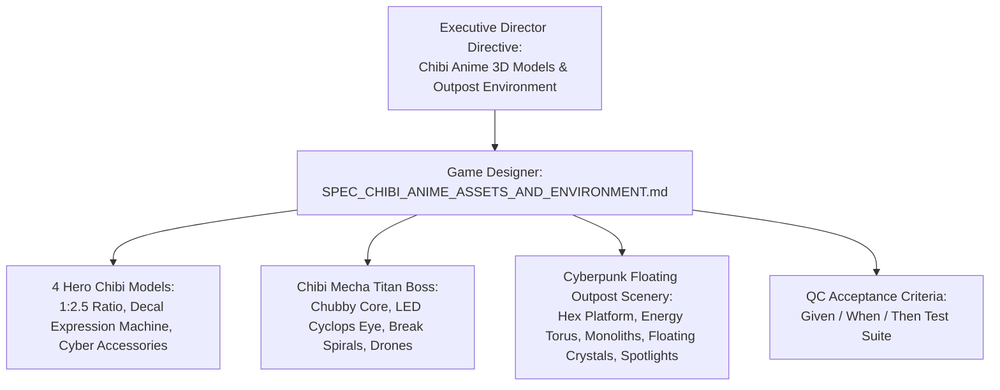
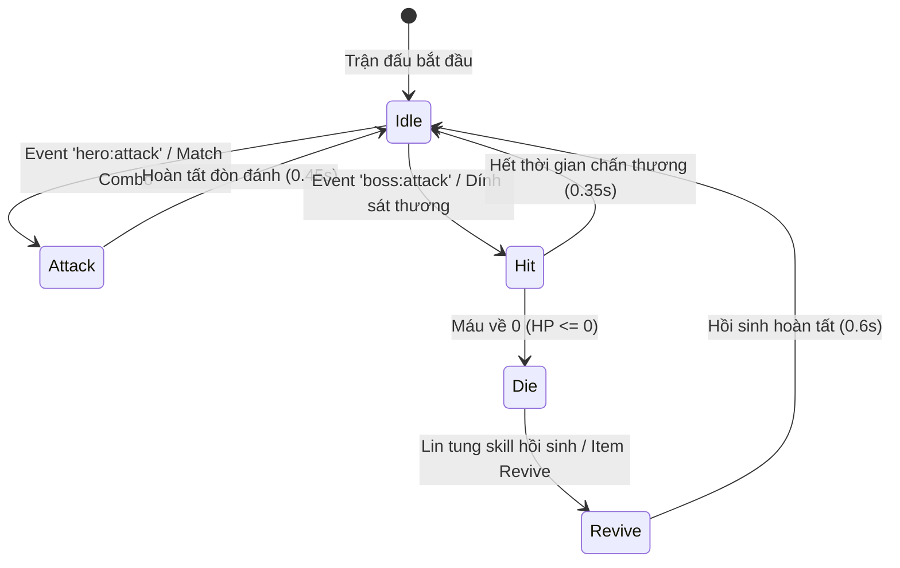

# [SPEC] THIẾT KẾ MÔ HÌNH 3D CHIBI ANIME & MÔI TRƯỜNG CHIẾN TRƯỜNG CYBERPUNK OUTPOST
### Feature Specification: 3D Chibi Anime Asset Design & Cyberpunk Floating Outpost Environment
*Tài liệu đặc tả hệ thống Game Design theo quy chuẩn Docs/MULTI_AGENT_WORKFLOW_SOP.md*  
*Mã tài liệu:* **SPEC-ART-3D-001** | *Phiên bản:* **1.1.0** | *Tác giả:* **Game Designer (`@game_designer`)**  
*Đối tượng thụ hưởng:* **QC Lead (`@qc_lead`)**, **Developers (`@cpp_core`, `@web_dev`)**, **Tech Art Lead (`@tech_art`)**  
*Trạng thái:* **BAN HÀNH CHÍNH THỨC (READY FOR QC TEST AUTHORING)**

---

## 1. TỔNG QUAN TÍNH NĂNG & TẦM NHÌN NGHỆ THUẬT (ART & GAMEPLAY VISION)

### 1.1. Mục Tiêu Trải Nghiệm (Core Design Intent)
Theo chỉ thị tối cao từ Executive Director: *"Xem xét thiết kế lại model 3d asset, thiết kế thêm môi trường giúp tôi, model asset style chibi anime nhé"*.

Mục tiêu cốt lõi của bản thiết kế này là chuyển dịch toàn bộ phong cách tạo hình chiến đấu sang chuẩn **Chibi Anime Sci-Fi (Stylized Chibi Gacha-grade)** kết hợp môi trường **Tiền Đồn Vũ Trụ Bay Cyberpunk (Cyberpunk Floating Outpost)** thuộc vũ trụ *Re:Fray*:
1. **Triệt tiêu cảm giác khô cứng, vô hồn:** Biến các nhân vật và quái vật khối thô thành các nhân vật Chibi sống động, mắt to long lanh, tóc uốn lượn, phụ kiện cơ khí ngộ nghĩnh nhưng đầy tính chiến thuật.
2. **Cung cấp phản hồi xúc giác thị giác (Dynamic Visual Affordance):** Mọi hành động trong trận đấu Match-3 (Match combo, Dính đòn, Boss Stagger Break, Hồi sinh, Tử trận) đều lập tức phản chiếu lên biểu cảm khuôn mặt (Facial Expressions) và dáng điệu nhún nhảy (Chibi Bobbing/Breathing Dynamics).
3. **Môi trường chiến trường sống động đa chiều:** Đưa người chơi vào không gian tiền đồn không gian viễn tưởng với vành đai năng lượng xoay ngầm, 4 tháp cự thạch Monoliths, tinh thể dữ liệu trôi nổi phản trọng lực, hệ thống đèn chiếu sân khấu kịch tính và hạt bụi không gian lơ lửng, tạo độ sâu trường ảnh (Depth of Field) vượt trội trên thiết bị di động.
4. **Chuẩn công thái học Mobile (Mobile Ergonomics & Anti-Visual Slop):** Đảm bảo tỷ lệ tương phản sắc nét, phông nền không gây nhiễu loạn thị giác bàn cờ match-3 bên dưới, giữ vững tốc độ khung hình 60 FPS với ngân sách polycount tinh gọn.



---

## 2. QUY CHUẨN TỶ LỆ & KHUNG HÌNH HỌC CHIBI ANIME (CHIBI PROPORTIONS & ANATOMY)

### 2.1. Tỷ Lệ Nhân Vật Vàng 1:2.5 (Super-Deformed Ratio)
Mô hình nhân vật được thiết kế theo tỷ lệ **1:2.5** (Đầu chiếm $40\% \rightarrow 45\%$ tổng chiều cao cơ thể), tối ưu hóa diện tích hiển thị khuôn mặt trên màn hình dọc (Portrait Mode) của thiết bị di động:

$$\text{Chiều cao tổng thể } H_{\text{hero}} = 1.35\text{m} \quad \Big( \text{Đầu: } 0.55\text{m}, \quad \text{Thân + Giáp: } 0.45\text{m}, \quad \text{Chân: } 0.35\text{m} \Big)$$

```
        ▲  +-------------------------+
        │  |     CHIBI HEAD (0.55m)  |  <- Tóc Stylized, Mắt Anime cực đại (55% diện tích mặt),
 1.35m  │  |   Sphere: [0.5, 24, 20] |     Biểu cảm Decal phản hồi 5 trạng thái cảm xúc.
        │  +-------------------------+
        │  |     CHIBI BODY (0.45m)  |  <- Giáp Techwear / Cyber Pauldrons / Balo năng lượng,
        │  |   Cylinder: [0.22, 0.4] |     Khớp cổ lắc lư theo nhịp thở (Breathing Cycle).
        │  +-------------------------+
        │  |     LEGS & BOOTS (0.35m)|  <- Chân ngắn bo tròn, bốt trọng lực vững chãi.
        ▼  +-------------------------+
```

### 2.2. Bảng Thông Số Hình Học & Vật Liệu (Geometry & Material Specifications)

| Thành phần | Hình học cơ bản (Geometry) | Kích thước chuẩn | Thuộc tính Vật liệu (Material Properties) |
| :--- | :--- | :--- | :--- |
| **Đầu Chibi (Head)** | `SphereGeometry(0.5, 24, 20)` (Scale $x=1.0, y=0.94, z=0.98$) | Bán kính 0.50m (Bè ngang nhẹ tạo má bầu) | Base Color `#ffe8dc` (Nền da trắng hồng), Roughness $0.50$, Metalness $0.05$. |
| **Mặt Anime (Face Decal)**| `PlaneGeometry(0.64, 0.64)` | $0.64\text{m} \times 0.64\text{m}$ (Decal dán trước trán) | `MeshBasicMaterial`, `transparent: true`, Texture Canvas độ phân giải $256 \times 256$. |
| **Tóc Anime Mái (Bangs)** | $5 \times \text{ConeGeometry}(0.18, 0.35, 4)$ | Xoay hình nan quạt phủ trán | Màu nguyên tố nhân vật, Roughness $0.35$, Metalness $0.10$. |
| **Thân Chibi (Body Torso)** | `CylinderGeometry(0.22, 0.28, 0.42, 12)` | Bán kính $0.22 - 0.28\text{m}$, Cao $0.42\text{m}$ | `MeshStandardMaterial`, Metalness $0.80$, Roughness $0.25$. |
| **Chân Bốt (Chibi Boots)**| $2 \times \text{CylinderGeometry}(0.10, 0.12, 0.35, 8)$ | Bán kính $0.10\text{m}$, Cao $0.35\text{m}$ | Giáp bốt cao su tổng hợp chịu lực, viền gót phản quang neon. |
| **Khối Thân Boss (Boss Core)**| `DodecahedronGeometry(1.6, 1)` | Bán kính khối $1.60\text{m}$, 12 mặt đa giác | Giáp Mecha đen Titanium `#1e293b`, Metalness $0.90$, Roughness $0.15$. |
| **Mắt Boss (Cyclops Eye)** | `CircleGeometry(0.55, 32)` | Bán kính $0.55\text{m}$ | Decal vòng LED Cyclops, phát xạ hào quang đa tầng. |

---

## 3. MÁY TRẠNG THÁI BIỂU CẢM KHUÔN MẶT 5 PHA (5-STATE FACIAL DECAL MATRIX)

Khuôn mặt nhân vật sử dụng hệ thống **Dynamic Face Decal Swapping**, tự động thay đổi texture 2D Canvas nét căng dựa theo sự kiện thời gian thực từ Gameplay EventBus:



### 3.1. Chi Tiết Trực Quan 5 Pha Cảm Xúc Của Hero

1. **Trạng thái Chờ / Bình thường (`normal` / `idle`):**
   * *Đôi mắt:* Tròn xoe cực đại, tròng mắt chuyển sắc Gradient 2 tầng (Ví dụ: Đỏ rực `#ef4444` $\rightarrow$ Hổ phách `#f59e0b` cho Astra). Đồng tử đen tuyền, có 2 điểm sáng phản quang lung linh (Highlight Sparkles: hạt lớn góc trên trái, hạt nhỏ góc dưới phải). Hàng lông mi trên cong vút.
   * *Gò má:* 2 vệt phấn hồng Chibi mềm mại dạng elip (`rgba(255, 120, 150, 0.35)`).
   * *Khuôn miệng:* Đường cong cười mỉm nhẹ nhàng, dễ thương.
2. **Trạng thái Tấn công (`attack`):**
   * *Đôi mắt:* Lông mày nhíu góc nhọn cương nghị, ánh mắt rực lửa tập trung hướng thẳng vào Boss.
   * *Khuôn miệng:* Há to hình bán nguyệt kiên định (`#e11d48`) hô vang khẩu hiệu xuất chiêu, khoe thần thái tự tin.
3. **Trạng thái Dính đòn (`hit`):**
   * *Đôi mắt:* Nhắm nghiền thành 2 dấu mũi tên sắc nhọn đối xứng `> <`, biểu cảm nhăn mặt ngộ nghĩnh trước lực va đập.
   * *Khuôn miệng:* Mở tròn kinh ngạc dạng chữ `O` hoảng hốt.
   * *Trauma Flash:* Toàn bộ mô hình nhấp nháy phát xạ trắng/đỏ trong $0.15\text{s}$.
4. **Trạng thái Tử trận (`die`):**
   * *Đôi mắt:* Nhắm tịt thành hai dấu `X_X` bằng nét vẽ dầy màu xám đậm `#475569`.
   * *Khuôn miệng:* Gợn sóng u buồn úp ngược $\sim$.
   * *Dáng điệu:* Hạ thấp $Y$, ngả nghiêng $45^\circ$, độ trong suốt giảm về $0.40$ (bóng ma Chibi).
5. **Trạng thái Hồi sinh / Chiến thắng (`revive` / `victory`):**
   * *Đôi mắt:* Cười tít thành hình 2 vầng trăng khuyết `^ ^`, lấp lánh hạt năng lượng hồi phục xanh ngọc.
   * *Dáng điệu:* Bật nảy lò xo ($Y$ nhảy vọt $0.4\text{m}$), vung tay reo hò.

### 3.2. Máy Trạng Thái Mắt Quái Boss Mecha Titan (Cyclops LED Core)

* **Bình thường (`normal`):** Vòng tròn mắt LED công nghệ cao với tâm phát sáng trắng, viền ngoài chuyển sắc theo hệ nguyên tố của Boss (Sentinel: Đỏ `#ff0044`, Warden: Băng `#00f0ff`, Sovereign: Hư Không `#a855f7`). Có 4 chữ thập căn ngắm (Reticle Crosshairs) mở rộng.
* **Tấn công (`attack`):** 4 Chữ thập thu nhỏ khóa chặt tâm ngắm (`Target Locked`), vòng năng lượng co lại cực đại và rực sáng màu đỏ cảnh báo.
* **Choáng ngợp / Vỡ giáp (`broken` / `stagger`):** Toàn bộ mắt Cyclops chuyển thành **Vòng Xoắn Ốc Hoa Mắt Chóng Mặt (Spiral Dizzy Reticle)** quay $720^\circ$, biểu cảm hài hước kinh điển của thể loại Chibi Anime khi Boss bị kiệt sức.

---

## 4. CHI TIẾT TRANG PHỤC & PHỤ KIỆN 4 HERO VÀ BOSS TITAN

Mỗi nhân vật Chibi mang hệ thống nhận diện màu sắc, kiểu tóc Anime và phụ kiện chiến đấu (Accessories) độc nhất:

```
[4 HEROES ROSTER]
├── ASTRA   (Attacker)  : Đuôi ngựa cao nhọn + Kính Cyber Visor + Song kiếm nhiệt hỏa
├── BORAN   (Defender)  : Giáp vai Mecha Titan + Sừng Cyber Horns + Đại khiên Aegis khổng lồ
├── ELYSIA  (Supporter) : Tóc Twintails 2 bên + Balo Hoodie tai mèo + 3 Quả cầu Hư Không lơ lửng
└── LIN     (Healer)    : Búi tóc tròn Odango + Vòng hào quang Nanite + Trượng y tế Thập Tự
```

### 4.1. Astra — Sát Thủ Hồng Liên (Attacker / Lửa)
* **Vị trí bố trí:** Tọa độ sàn đấu $(x = -2.3, z = 1.2)$.
* **Mái tóc Anime:** Đuôi ngựa cao nhọn vút ngược về phía sau (`ConeGeometry(0.28, 0.85, 8)`), buộc bằng dải ruy băng cơ khí màu vàng cam rực cháy. Tóc màu tím hồng dạ quang `#d946ef`.
* **Phụ kiện Cyber Visor:** Kính ngắm quang học gắn bên tai trái (`BoxGeometry(0.12, 0.14, 0.28)` màu Cyan neon `#00f0ff`), quét mục tiêu liên tục.
* **Trang phục Techwear:** Áo khoác hở vai năng động phối màu đen than `#111827` và cam neon `#f97316`.
* **Vũ khí Chibi:** Song Kiếm Nhiệt Khí Nén (**Dual Thermal Katanas**). Lưỡi kiếm ngoại cỡ (Oversized Blades) dài $1.15\text{m}$, lưỡi kiếm phát quang màu đỏ lửa `#ef4444`. Khi tấn công, vung chém theo hình chữ X rực lửa.

### 4.2. Boran — Bức Tường Thép Vùng Biên (Defender / Đất - Phòng Ngự)
* **Vị trí bố trí:** Tọa độ sàn đấu $(x = 2.3, z = 1.2)$.
* **Mái tóc Anime:** Tóc ngắn cắt tỉa góc cạnh phong cách chiến binh mech, màu xanh navy sẫm `#1e3a8a`.
* **Phụ kiện Giáp Vai Mecha Pauldrons:** Cặp giáp vai Titan ngoại cỡ (`BoxGeometry(0.35, 0.25, 0.35)`) thiết kế góc nhọn vát sắc cạnh, có 2 sừng vi mạch mini (Cyber Horns) ở tai nghe.
* **Trang phục Hạng Nặng:** Giáp ngực nguyên khối hợp kim với lò phản ứng hồ quang mini phát sáng xanh biển `#2563eb` giữa ngực.
* **Vũ khí Chibi:** Đại Khiên Hộ Quốc (**Aegis Force Shield**). Tấm khiên hình lục giác khổng lồ cao $0.95\text{m}$, rộng $0.7\text{m}$ (chiếm $75\%$ chiều cao cơ thể Boran), viền khiên bọc trường lực phát sáng `#38bdf8`. Khi phòng thủ, Boran cắm khiên xuống sàn tạo sóng xung kích bảo vệ đồng đội.

### 4.3. Elysia — Phân Tích Viên Tín Hiệu (Supporter / Tím - Hư Không)
* **Vị trí bố trí:** Tọa độ sàn đấu $(x = -0.75, z = 1.5)$.
* **Mái tóc Anime:** Mái tóc hai chùm bồng bềnh uốn lượn phong cách Anime Twintails (`CylinderGeometry(0.1, 0.04, 0.75, 8)`), rủ xuống qua vai, màu tím thạch anh `#a855f7`.
* **Phụ kiện Balo & Tai Mèo Cyber:** Tai nghe cảm biến sóng không gian hình tai mèo điện tử (Cyber Cat-Ear Headset) có anten bắt tín hiệu nhấp nháy đèn LED.
* **Trang phục Công Nghệ:** Áo măng-tô ngắn tay dáng hoodie, lót vải hologram phản quang đa sắc.
* **Vũ khí Chibi:** Cụm Tam Cầu Hư Không (**Trio Void Orbs**). 3 Quả cầu năng lượng tím bay lơ lửng xung quanh thân Elysia theo quỹ đạo hình elip bán kính $0.65\text{m}$, tự xoay quanh trục với vận tốc $\omega = 1.8\text{ rad/s}$. Khi tung buff, các quả cầu bắn tia laser liên kết đến các Hero khác.

### 4.4. Lin — Thiên Sứ Hồi Sinh Nanite (Healer / Lục - Sinh Mệnh)
* **Vị trí bố trí:** Tọa độ sàn đấu $(x = 0.75, z = 1.5)$.
* **Mái tóc Anime:** 2 Búi tóc tròn đôi Chibi Odango (`SphereGeometry(0.2, 12, 12)`) gắn kẹp tóc vi mạch hoa anh đào, màu xanh lục bảo `#059669`.
* **Phụ kiện Vòng Hào Quang Thiên Thần Nanite (Nanite Halo):** Vòng hào quang ánh sáng (`TorusGeometry(0.35, 0.035, 12, 32)`) lơ lửng trên đỉnh đầu $0.32\text{m}$, nghiêng $15^\circ$, liên tục xoay tròn chậm rãi phát tán bụi phấn sinh học.
* **Trang phục Quân Y:** Váy y tá quân sự công nghệ cao phối màu trắng tinh khiết `#f8fafc` và xanh lục mint `#10b981`. Túi cứu thương chữ thập mini đeo bên hông.
* **Vũ khí Chibi:** Quyền Trượng Thập Tự Sinh Mệnh (**Caduceus Nanite Staff**). Cán trượng kim loại trắng, đầu trượng hình chữ thập phát quang phát ra các hạt ánh sáng xanh lá lấp lánh khi niệm phép hồi phục.

### 4.5. Boss Titan Chibi Mecha — Sentinel Unit 07 & Các Biến Thể
* **Vị trí bố trí:** Tọa độ trung tâm hậu phương $(x = 0, y = 2.1, z = -1.8)$.
* **Tạo hình Chibi Mecha:**
  * Thân khối bầu bĩnh (Chubby Mecha Body): Sử dụng khối 12 mặt (`DodecahedronGeometry(1.6)`) tạo vẻ ngoài cơ giới đồ sộ nhưng bo góc đáng yêu.
  * Mắt Cyclops khổng lồ đặt chính diện với khả năng đổi texture biểu cảm như mục 3.2.
  * 2 Ống pháo cối mini gắn trên vai (`CylinderGeometry(0.25, 0.35, 0.9)`), vểnh lên góc $35^\circ$.
* **Hộ Vệ Mini Drones:** 2 Drone hình thoi bay lượn ở 2 bên cánh $(x = \pm 3.2, y = 2.4, z = -1.2)$, liên tục bập bênh theo sóng sin và xoay quanh Boss để bảo vệ lõi năng lượng.

---

## 5. MÔI TRƯỜNG CHIẾN TRƯỜNG: TIỀN ĐỒN VŨ TRỤ CYBERPUNK (CYBERPUNK FLOATING OUTPOST)

Toàn bộ quang cảnh chiến trường được nâng cấp thành một bệ phóng năng lượng không gian đa tầng lơ lửng giữa biển mây điện từ:

```
[CYBERPUNK FLOATING OUTPOST ARCHITECTURE]
├── 1. ARENA FLOOR        : Bệ trụ Hex-Grid đa tầng, rãnh Neon tổ ong + 2 Vòng xoay ngầm
├── 2. OUTER ENERGY TORUS : Vành đai năng lượng Cyan bao bọc vành đai bảo vệ sàn đấu
├── 3. MONOLITHS (x4)     : 4 Cột tháp bát giác cự thạch ở 4 góc với dải LED Neon chạy dọc
├── 4. FLOATING CRYSTALS  : Tinh thể bát diện trôi nổi trên đỉnh cột + Bụi tinh thể vỡ
├── 5. HOLO-SCREENS (x2)  : Màn hình tác chiến Hologram bán trong suốt hiển thị thông số Boss
├── 6. CINEMATIC LIGHTING : Đèn rọi sân khấu Key/Rim Spotlights + Phản quang sàn đấu Neon
└── 7. CYBER PARTICLES    : Hệ thống hạt bụi năng lượng Cyber Dust lơ lửng tạo chiều sâu
```

### 5.1. Sàn Đấu Trung Tâm & Vành Đai Năng Lượng Ngầm (Hex-Grid Floating Platform)
1. **Hình học bệ đỡ:** Khối trụ dẹt đa giác (`CylinderGeometry(5.4, 5.8, 0.45, 48)`), phủ texture kim loại sẫm màu `#0a0e1c` khắc rãnh lục giác tổ ong Neon Cyan `rgba(0, 240, 255, 0.22)`.
2. **Vành đai Neon bảo vệ biên độ (Outer Neon Border Ring):**
   * Vòng Torus kim loại bảo vệ chu vi sàn đấu (`TorusGeometry(5.45, 0.08, 16, 64)`), phát quang màu Cyan rực rỡ `#00f0ff`.
3. **Vòng xoay năng lượng ngầm (Sub-floor Rotating Energy Rings):**
   * Vòng nhẫn năng lượng đồng tâm nằm ngay trên mặt sàn (`RingGeometry(3.0, 3.25, 48)` màu Cyan Sky `#38bdf8`).
   * **Động lực học:** Vòng xoay liên tục quanh trục thẳng đứng $Y$ với vận tốc góc:
     $$\omega_{\text{ring}} = 0.35\text{ rad/s}$$
   * Tạo cảm giác cỗ máy phản trọng lực đang vận hành liên tục bên dưới chân các nhân vật.

### 5.2. 4 Cột Tháp Cự Thạch Năng Lượng (Monolith Pillars) & Tinh Thể Dữ Liệu Bay Lơ Lửng
Tại 4 vị trí chiến lược bao quanh sàn đấu:
* Góc Tây Bắc: $(x = -5.0, z = -2.8)$
* Góc Đông Bắc: $(x = 5.0, z = -2.8)$
* Góc Tây Nam: $(x = -5.6, z = 1.5)$
* Góc Đông Nam: $(x = 5.6, z = 1.5)$

1. **Thân cột tháp:** Cột lăng trụ bát giác (`CylinderGeometry(0.35, 0.45, 3.2, 8)`) bằng vật liệu Titanium bóng đêm `#111827`, có dải LED Neon thẳng đứng chạy dọc thân cột chuyển đổi giữa Cyan `#00f0ff` và Tím Neon `#a855f7`.
2. **Tinh thể dữ liệu lơ lửng trên đỉnh cột (Levitating Data Crystals):**
   * Đặt ở độ cao $y = 3.3\text{m}$ (cách đỉnh cột $0.5\text{m}$).
   * Hình học: Khối bát diện đều (`OctahedronGeometry(0.30, 0)`), khung lưới Wireframe phát sáng neon.
   * **Động lực học bay lơ lửng:** Tinh thể xoay 3 trục đồng thời dao động điều hòa theo trục thẳng đứng:
     $$y_{\text{crystal}}(t) = y_{\text{base}} + A \cdot \sin(\omega t + \phi_i)$$
     Trong đó: Biên độ $A = 0.12\text{m}$, tần số góc $\omega = 2.4\text{ rad/s}$, pha lệch giữa các cột $\phi_i = i \cdot \frac{\pi}{2}$.

### 5.3. Màn Hình Hologram Tác Chiến Ba Chiều (Tactical Holo-Screens)
* Bố trí 2 màn hình Hologram lơ lửng tại hậu cảnh $(x = \pm 2.8, y = 3.2, z = -4.0)$ quay nghiêng góc $20^\circ$ hướng về phía người chơi.
* Hiển thị giao diện dữ liệu radar quân sự, dòng chữ điện tử nhấp nháy:
  * `SENTINEL TARGET LOCK: 100%`
  * `COMBO PROTOCOL: ONLINE`
  * `STAGGER BREAK: ARMED`
* Chất liệu: `MeshBasicMaterial`, `transparent: true`, `opacity: 0.75`, `side: THREE.DoubleSide`.

### 5.4. Hệ Thống Chiếu Sáng Kịch Tính & Đèn Chiếu Sàn Đấu (Cinematic Arena Spotlights)
Để triệt tiêu hiện tượng phẳng hình (Flat shading) và làm nổi khối nhân vật 3D Chibi trên di động, hệ thống sử dụng bố cục ánh sáng 3 điểm điện ảnh (Three-Point Lighting):
1. **Đèn chiếu chính (Key Spotlight):**
   * Đèn rọi chéo từ trên cao phía trước $(x = 2.0, y = 8.0, z = 6.0)$ rọi thẳng vào trung tâm đấu trường.
   * Màu ánh sáng: Trắng lạnh pha xanh băng `#e0f2fe`, cường độ $1.85$, góc tỏa $\text{angle} = \frac{\pi}{3}$, độ mờ biên penumbra $0.4$, tạo bóng đổ sắc nét (Crisp Shadows) dưới chân các Hero.
2. **Đèn viền tương phản (Rim Light / Backlight):**
   * Đèn rọi ngược từ phía sau Boss $(x = 0, y = 4.5, z = -6.0)$ hướng về đội hình Hero.
   * Màu ánh sáng: Tím hồng Neon `#ec4899`, cường độ $1.20$, tạo một đường viền phát sáng rực rỡ ôm lấy viền tóc Chibi và bờ vai giáp trụ của các Hero, giúp nhân vật tách bạch hoàn toàn khỏi phông nền tối.
3. **Đèn hắt sàn Neon (Floor Ambient Uplight):**
   * Ánh sáng phản xạ gián tiếp từ mặt sàn tổ ong màu Cyan `#00f0ff` hắt nhẹ lên gầm áo giáp và đế giày các nhân vật.
4. **Phản ứng ánh sáng kịch tính khi nổ chiêu (Dramatic Action Dimming):**
   * Khi người chơi kích hoạt Ultimate hoặc Boss chuẩn bị xả pháo, ánh sáng môi trường tự động dìm tối $45\%$ trong $0.6\text{s}$, đồng thời tăng cường Spotlight tập trung vào nhân vật thi triển, tạo khoảnh khắc "Showcase" đẳng cấp anime.

### 5.5. Hạt Bụi Năng Lượng Lơ Lửng (Ambient Cyber Particles)
* Hệ thống 75 điểm hạt phát sáng (`Points Material`, hạt kích thước $0.08\text{m}$, màu Sky Cyan `#38bdf8`, chế độ hòa trộn Additive Blending).
* Chuyển động Brown lơ lửng trong không gian hộp chiến trường kích thước $[-5.5 \le x \le 5.5, 0.2 \le y \le 4.7, -4.0 \le z \le 4.0]$. Khi hạt trôi vượt quá đỉnh $y > 4.7\text{m}$, nó được tái sinh ở đáy sàn $y = 0.2\text{m}$.

---

## 6. HỆ THỐNG CÔNG THỨC TOÁN HỌC & ĐỘNG LỰC HỌC HOẠT ẢNH (DYNAMIC MATH SPECS)

### 6.1. Nhịp Thở Chibi Tự Nhiên (Chibi Breathing & Bobbing Cycle)
Mọi nhân vật ở trạng thái Idle không đứng yên vô hồn mà liên tục nhún nhảy theo chu kỳ điều hòa tự nhiên:

$$\Delta y_{\text{bob}}(t) = A_{\text{bob}} \cdot \sin(2\pi \cdot f_{\text{bob}} \cdot t + \phi_0)$$
$$\text{Scale}_y(t) = 1.0 + A_{\text{squash}} \cdot \sin(2\pi \cdot f_{\text{bob}} \cdot t)$$
$$\text{Scale}_{x,z}(t) = 1.0 - \frac{A_{\text{squash}}}{2} \cdot \sin(2\pi \cdot f_{\text{bob}} \cdot t)$$

* **Bảng tham số chuẩn hóa:**
  * Tần số thở Chibi: $f_{\text{bob}} = 1.25\text{ Hz}$ (Chu kỳ $T = 0.8\text{s}$).
  * Biên độ nhún nhảy: $A_{\text{bob}} = 0.045\text{m}$ (Hero), $0.025\text{m}$ (Boss).
  * Biên độ Squash & Stretch đầu Chibi: $A_{\text{squash}} = 0.035$.

### 6.2. Động Lực Học Lao Đòn Tấn Công (Attack Lunge Damping Curve)
Khi tung chiêu, Hero lướt nhanh về phía trước $Z$ tới vị trí mục tiêu rồi giật lùi về vị trí cũ theo hàm tắt dần có giảm chấn (Underdamped Harmonic Motion):

$$z(t) = z_0 - D_{\text{lunge}} \cdot e^{-\zeta \omega_n t} \cdot \sin(\omega_d t)$$

* Khoảng cách lao tới: $D_{\text{lunge}} = 0.85\text{m}$.
* Hệ số giảm chấn: $\zeta = 0.65$.
* Tần số dao động: $\omega_n = 14.0\text{ rad/s}$.
* Thời gian hoàn tất đòn đánh: $t_{\text{attack}} = 0.45\text{s}$.

### 6.3. Rung Chấn Va Đập Khi Dính Sát Thương (Trauma Shake Formulation)
Khi nhân vật hoặc Boss trúng đòn nặng, biên độ rung lắc màn hình và thân thể tuân thủ công thức suy giảm phi tuyến tính bậc 2:

$$\text{Offset}_x(t) = \text{Trauma}^2 \cdot \text{MaxShake} \cdot \text{noise}(t)$$
$$\text{Trauma}(t) = \max(0, \; \text{Trauma}_0 - \lambda \cdot \Delta t)$$

* $\text{Trauma}_0$: Khởi tạo $1.0$ khi trúng đòn chí mạng, $0.5$ khi trúng đòn thường.
* Tốc độ tắt rung: $\lambda = 2.8\text{ s}^{-1}$ (Thời gian rung dứt khoát trong $0.35\text{s}$).
* Độ lệch tối đa: $\text{MaxShake} = 0.22\text{m}$.

---

## 7. ĐIỀU KIỆN RẼ NHÁNH & CÁC TRƯỜNG HỢP BIÊN (EDGE CASES & BRANCHING)

| Tình huống / Trường hợp biên | Điều kiện kích hoạt (Branching Condition) | Hành vi thị giác & Quy tắc hệ thống (System & Visual Behavior) |
| :--- | :--- | :--- |
| **Edge Case 1: Cả 4 Hero đồng loạt dính đòn diện rộng (Boss AoE)** | Boss hoàn tất đếm lượt và xả kỹ năng quét sàn. | Toàn bộ 4 Hero đồng loạt chuyển biểu cảm `hit` (> <), thân người giật lùi $-0.3\text{m}$, chớp đỏ $0.15\text{s}$. Không xung đột bộ đếm timer (mỗi Hero sở hữu `hitTimer` độc lập). |
| **Edge Case 2: Hero bị hạ gục ngay trong lượt combo nhiều bước** | $\text{HP}_{\text{hero}} \le 0$ khi đợt phản đòn xảy ra giữa chuỗi match. | Trạng thái chuyển ngay sang `isDefeated = true`, biểu cảm dán nhãn `die` (X_X), không tiếp tục kích hoạt diễn hoạt `attack` hay `hit` cho đến khi có lệnh hồi sinh. |
| **Edge Case 3: Lin hồi sinh đồng đội vừa ngã xuống** | Lin tích lũy đủ mana xanh lục hoặc match combo kích hoạt kỹ năng cứu thương. | Hero mục tiêu chuyển trạng thái `revive`, bật dậy tức thì, đổi biểu cảm sang mắt trăng khuyết `^ ^`, vòng hào quang Nanite chớp sáng xanh ngọc trên đầu. |
| **Edge Case 4: Boss bị phá vỡ thanh kiệt sức (Stagger Break)** | Chỉ số Giáp/Stagger của Boss tụt về $0$. | Boss ngừng toàn bộ đòn đánh, thân sụp xuống $0.35\text{m}$, mắt Cyclops chuyển sang dạng xoắn ốc chóng mặt (`broken` spiral reticle), toàn thân rung chấn và khói tím bốc lên trong 2 lượt. |
| **Edge Case 5: Tải tài nguyên trên thiết bị di động cấu hình yếu** | Bộ nhớ GPU thấp hoặc WebGL giới hạn texture size. | Hệ thống tự động tạo texture Canvas 2D theo thời gian thực ($256 \times 256$), không tải file ảnh ngoài dung lượng lớn, đảm bảo $100\%$ không bị gián đoạn màn hình hoặc tràn bộ nhớ (Out of Memory). |
| **Edge Case 6: Thu nhỏ / Đổi hướng màn hình (Portrait $\leftrightarrow$ Landscape)** | Sự kiện `window.resize` hoặc đổi xoay màn hình điện thoại. | Camera tự động điều chỉnh khoảng cách $Z$ và tiêu cự để đảm bảo toàn bộ 4 Hero và Boss luôn nằm trọn vẹn trong vùng an toàn (Safe Zone), không bị che khuất bởi lưới Match-3. |

---

## 8. BỘ TIÊU CHUẨN NGHIỆM THU ĐỘC LẬP (ACCEPTANCE CRITERIA FOR QC)

Toàn bộ các tiêu chí nghiệm thu dưới đây được biên soạn theo định dạng chuẩn **Given / When / Then**. Đội ngũ QC Lead (`@qc_lead`) bắt buộc phải dựa vào các điều khoản này để viết bộ kiểm thử tự động độc lập (`test_chibi_anime_models_and_scenery.mjs` hoặc bộ test C++/Web).

### Nhóm AC 1: Cấu Trúc Khởi Tạo 4 Mô Hình Hero Chibi Anime (Hero Hierarchy)
* **AC 1.1:**
  * **Given:** Hệ thống 3D Diorama được khởi tạo với trạng thái bàn chơi mới.
  * **When:** Hàm khởi tạo `buildChibiHeroes()` hoàn tất.
  * **Then:** Mảng `diorama.heroes` phải chứa đúng chính xác 4 nhân vật, tương ứng với 4 Role theo thứ tự chuẩn: `['Attacker', 'Supporter', 'Healer', 'Defender']`.
* **AC 1.2:**
  * **Given:** Mỗi nhân vật Chibi trong danh sách `diorama.heroes`.
  * **When:** Kiểm tra cây phân cấp đối tượng Three.js (Scene Graph).
  * **Then:** Nhân vật bắt buộc phải sở hữu đầy đủ:
    1. `rootGroup`: Tọa độ neo vị trí sàn đấu.
    2. `bodyGroup`: Cụm khớp nhún nhảy cho hoạt ảnh Breathing/Bobbing.
    3. `headMesh`: Khối cầu đầu Chibi bo tròn tỷ lệ 1:2.5.
    4. `faceMesh`: Mặt phẳng Decal gắn trước đầu hiển thị biểu cảm 2D.
    5. `weapon`: Mô hình vũ khí đại diện cho hệ nguyên tố của Role đó.

### Nhóm AC 2: Biểu Cảm Khuôn Mặt & Máy Trạng Thái Hoạt Ảnh 5 Pha
* **AC 2.1 (Idle biểu cảm bình thường):**
  * **Given:** Trận đấu đang diễn ra và Hero không thực hiện thao tác hay dính sát thương.
  * **When:** Kiểm tra trạng thái của Hero.
  * **Then:** `hero.state` phải bằng `'idle'` và texture của `hero.face.material.map` phải trỏ đúng vào `hero.faceTex.normal`.
* **AC 2.2 (Biểu cảm tấn công):**
  * **Given:** Người chơi thực hiện nước đi tạo sát thương của Astra.
  * **When:** Phương thức `diorama.playHeroAttack(hero)` được gọi.
  * **Then:** `hero.state` lập tức chuyển thành `'attack'`, texture khuôn mặt đổi sang `hero.faceTex.attack` (mắt quyết tâm, miệng cười chiến đấu) và tọa độ $Z$ của Hero phải dịch chuyển về phía trước tối thiểu $0.3\text{m}$.
* **AC 2.3 (Biểu cảm dính đòn):**
  * **Given:** Boss tung đòn đánh trúng vào Hero.
  * **When:** Phương thức `diorama.playHeroHit(hero)` được gọi.
  * **Then:** `hero.state` chuyển sang `'hit'`, texture khuôn mặt đổi sang `hero.faceTex.hit` (mắt nheo lại `> <`, miệng chữ `O`) và biến `hero.shakeTimer` phải nhận giá trị dương $> 0$.
* **AC 2.4 (Biểu cảm tử trận):**
  * **Given:** Hero bị cạn kiệt lượng máu về mức $0$.
  * **When:** Phương thức `diorama.playHeroDie(hero)` được gọi.
  * **Then:** Cờ `hero.isDefeated` phải chuyển thành `true`, `hero.state` thành `'die'`, texture khuôn mặt đổi sang `hero.faceTex.die` (mắt nhắm tịt `X_X`) và độ xoay trục $X$ của thân người phải ngả ra sau một góc từ $30^\circ \rightarrow 50^\circ$.
* **AC 2.5 (Biểu cảm hồi sinh):**
  * **Given:** Hero đang ở trạng thái tử trận (`hero.isDefeated === true`).
  * **When:** Phương thức `diorama.playHeroRevive(hero)` được kích hoạt.
  * **Then:** Cờ `hero.isDefeated` phải trở về `false`, `hero.state` chuyển sang `'revive'`, và vị trí $Y$ của Hero phải bật nảy lên cao hơn vị trí mặt đất cơ sở ít nhất $0.3\text{m}$.

### Nhóm AC 3: Phụ Kiện Vũ Khí & Nhận Diện Hero
* **AC 3.1 (Astra - Attacker):**
  * **Given:** Nhân vật Astra (`role === 'Attacker'`).
  * **When:** Kiểm tra phụ kiện đính kèm trên mô hình.
  * **Then:** Astra phải có: Đuôi ngựa tóc nhọn phía sau, Kính ngắm vi tính tử (Cyber Visor) màu Cyan bên thái dương trái, và 2 thanh Katana nhiệt hỏa màu đỏ rực.
* **AC 3.2 (Boran - Defender):**
  * **Given:** Nhân vật Boran (`role === 'Defender'`).
  * **When:** Kiểm tra phụ kiện đính kèm trên mô hình.
  * **Then:** Boran phải có: Giáp vai Mecha đôi ngoại cỡ, Sừng năng lượng mini trên tai nghe, và Khiên phòng ngự Aegis lục giác khổng lồ cao tối thiểu $0.8\text{m}$.
* **AC 3.3 (Elysia - Supporter):**
  * **Given:** Nhân vật Elysia (`role === 'Supporter'`).
  * **When:** Kiểm tra phụ kiện đính kèm trên mô hình.
  * **Then:** Elysia phải có: 2 Bím tóc Anime dài hai bên (Twintails), Balo tai mèo cyber, và tối thiểu 2 Quả cầu Hư Không (Void Orbs) trôi nổi bay quanh thân.
* **AC 3.4 (Lin - Healer):**
  * **Given:** Nhân vật Lin (`role === 'Healer'`).
  * **When:** Kiểm tra phụ kiện đính kèm trên mô hình.
  * **Then:** Lin phải có: 2 Búi tóc Odango tròn trên đỉnh đầu, Vòng hào quang Nanite Halo phát sáng trôi nổi trên không, và Trượng y tế Thập Tự Nanite.

### Nhóm AC 4: Cấu Trúc Model Boss Chibi Mecha Titan
* **AC 4.1 (Khởi tạo Boss):**
  * **Given:** Sân đấu 3D Diorama được khởi tạo.
  * **When:** Boss được sinh ra trong màn chơi.
  * **Then:** Đối tượng `diorama.boss` không được mang giá trị `null`, phải có khối thân đa diện Chibi Mecha `boss.body`, mắt Cyclops LED `boss.eye`, và kèm theo chính xác 2 Drone hộ vệ Chibi (`diorama.drones.length === 2`).
* **AC 4.2 (Biểu cảm mắt Boss khi Choáng Váng - Stagger Break):**
  * **Given:** Boss đang ở trạng thái bình thường với texture mắt `bossEyeTexNormal`.
  * **When:** Sự kiện kiệt sức (Stagger Break) xảy ra hoặc hàm `setBossStaggerBreak(true)` được gọi.
  * **Then:** Texture mắt của Boss `boss.eye.material.map` bắt buộc phải chuyển sang `diorama.bossEyeTexBroken` (vòng tròn xoắn ốc $720^\circ$ hoa mắt chóng mặt).
* **AC 4.3 (Boss tấn công & Dính sát thương):**
  * **Given:** Boss thi triển đòn đánh hoặc bị người chơi combo trúng.
  * **When:** Gọi `diorama.playBossAttack()` hoặc `diorama.playBossHit()`.
  * **Then:** Khi tấn công, `boss.state` phải là `'attack'`. Khi dính đòn, biến `boss.shakeTimer` phải lớn hơn $0$ để kích hoạt hiệu ứng rung chấn Trauma Shake.

### Nhóm AC 5: Quang Cảnh Môi Trường Tiền Đồn Bay Cyberpunk (Outpost Scenery)
* **AC 5.1 (Sàn đấu & Vòng xoay ngầm):**
  * **Given:** Quang cảnh môi trường sân đấu được dựng xong.
  * **When:** Truy xuất đối tượng sàn đấu `diorama.stageGroup`.
  * **Then:** Bắt buộc phải tồn tại:
    1. Vòng xoay năng lượng ngầm `diorama.underRingMesh`.
    2. Vành đai viền neon bảo vệ sàn đấu dạng Torus.
* **AC 5.2 (4 Cột tháp Monoliths & Tinh thể bay lơ lửng):**
  * **Given:** Không gian đấu trường 3D.
  * **When:** Đếm số lượng cấu kiện cự thạch trong mảng `diorama.sceneryProps`.
  * **Then:** Mảng `diorama.sceneryProps` phải có độ dài đúng bằng 4, mỗi phần tử phải chứa một cụm cột bát giác và một tinh thể đa diện bay lơ lửng `prop.crystal`.
* **AC 5.3 (Hệ thống hạt bụi năng lượng Cyber Dust):**
  * **Given:** Môi trường đấu trường đang hoạt động.
  * **When:** Kiểm tra đối tượng hạt không gian.
  * **Then:** `diorama.ambientParticles` không được `null`, phải là một đối tượng `THREE.Points` chứa tối thiểu 50 hạt năng lượng chuyển động liên tục.
* **AC 5.4 (Vòng lặp cập nhật Update Loop):**
  * **Given:** Đấu trường đang trong trận đấu thực tế ở tần số 60 FPS.
  * **When:** Hàm `diorama.update(deltaTime, elapsedTime)` được thực thi liên tục mỗi frame.
  * **Then:** Không được phát sinh bất kỳ ngoại lệ nào (`Exception / Crash`), các tinh thể dữ liệu trên cột phải có tọa độ $Y$ thay đổi theo thời gian, và vòng xoay năng lượng ngầm phải quay góc liên tục.

---

## 9. ĐIỀU PHỐI THỰC THI & CHUYỂN GIAO TIẾP THEO (NEXT STEPS & HANDOFF)

Tài liệu đặc tả này là cơ sở bất biến duy nhất để các trạm thực thi theo quy trình 5 bước của `Docs/MULTI_AGENT_WORKFLOW_SOP.md`:
1. **Chuyển giao cho Trạm QC (`@qc_lead`):**
   * Đọc các điều khoản AC từ Mục 8 để viết và cập nhật trọn vẹn bộ kiểm thử tự động tại `Web/test_chibi_anime_models_and_scenery.mjs`.
   * Chạy kiểm thử tự động trong môi trường Node.js headless với Exit Code 0.
2. **Chuyển giao cho Trạm Dev (`@web_dev` & `@cpp_core`):**
   * Đối chiếu với Spec để kiểm tra, tinh chỉnh và hoàn thiện logic diễn hoạt 3D trong `Web/src/three/Diorama3D.js` (hoặc tầng Unreal Engine tương đương nếu dựng C++).
   * Tuyệt đối không hardcode, tuân thủ đúng bảng tọa độ và công thức toán học đã quy định tại Mục 6.
3. **Chuyển giao cho Trạm Tech Art (`@tech_art`):**
   * Thẩm định độ tương phản ánh sáng sân khấu Key/Rim Spotlights, bảo đảm các nhân vật Chibi nổi bật rõ nét trên nền tối của tiền đồn Cyberpunk Outpost.
   * Giám sát ngân sách Draw Calls $< 25$ và Polycount $< 20,000$ tris trên WebGL mobile.

---
*Tài liệu được ký duyệt bởi Game Designer — Bản quyền thuộc về Dự án Match-3 RPG Re:Fray.*
