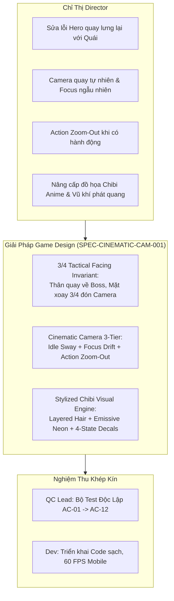
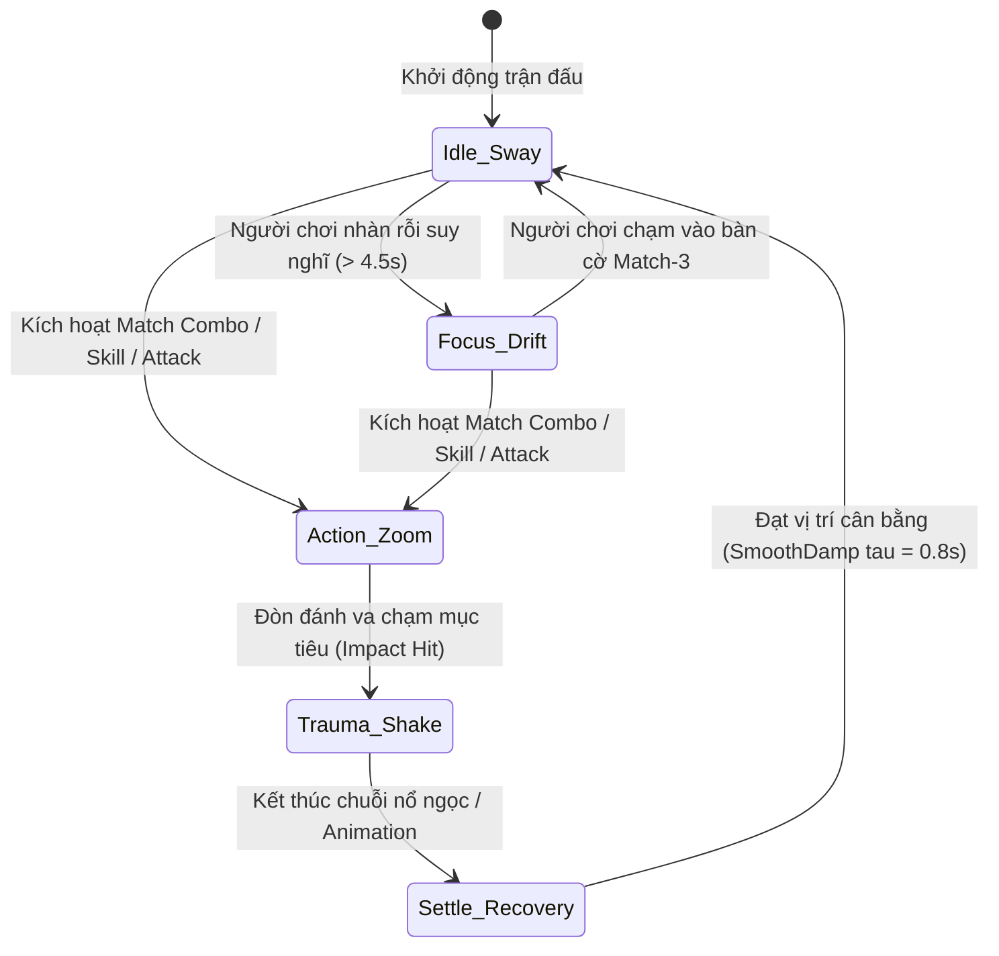

# [SPEC] ĐẠO DIỄN CINEMATIC DYNAMIC CAMERA & HƯỚNG NHÌN CHIẾN THUẬT 3/4 TACTICAL CHIBI ANIME
### Feature Specification: Cinematic Dynamic Camera Engine & 3/4 Tactical Hero Facing System
*Tài liệu đặc tả hệ thống Game Design theo quy chuẩn Docs/MULTI_AGENT_WORKFLOW_SOP.md*  
*Mã đặc tả:* **SPEC-CINEMATIC-CAM-001** | *Phiên bản:* **1.0.0** | *Tác giả:* **Game Designer (`@game_designer`)**  
*Căn cứ kỹ thuật:* [chibi-3d-character-design](file:///d:/self/match-3-rpg/.agents/skills/chibi-3d-character-design/SKILL.md), [cinematic-camera-director](file:///d:/self/match-3-rpg/.agents/skills/cinematic-camera-director/SKILL.md)  
*Đối tượng thụ hưởng:* **QC Lead (`@qc_lead`)**, **Developers (`@web_dev`, `@cpp_core`)**, **Tech Art Lead (`@tech_art`)**  
*Trạng thái:* **BAN HÀNH CHÍNH THỨC — CHUYỂN GIAO QC VIẾT TEST**

---

## 1. TỔNG QUAN & BỐI CẢNH CHỈ THỊ (EXECUTIVE CONTEXT)

Theo chỉ thị trực tiếp từ Executive Producer & Game Director qua Mobile Command Queue:
> *"Mô hình 3d còn xấu quá, sao lại để nhân vật quay lưng lại số với quái??? Camera nên để quay tự nhiên và focus random, khi có hành động thì zoom out, xem xét thiết kế lại, cài thêm những skill illust và 3d design để thiết kế và duyệt lại asset giúp tôi"*

Bản đặc tả này xử lý triệt để 3 vấn đề lớn trong trải nghiệm thị giác chiến trường 3D của *RE:FRAY*:
1. **Triệt tiêu lỗi tạo hình phản cảm:** Sửa chữa hoàn toàn lỗi các Heroes đang quay lưng lại với Boss titan. Áp dụng chuẩn **3/4 Tactical Stance** kinh điển của dòng game RPG Gacha cao cấp (Honkai: Star Rail, Genshin Impact, Nikke), giúp nhân vật vừa thủ thế nghênh địch đối mặt Boss, vừa phô diễn được góc mặt Chibi Anime mắt tròn lung linh và vũ khí phát quang trước ống kính máy quay.
2. **Nâng tầm trải nghiệm điện ảnh (Cinematic Dynamic Camera):** Xóa bỏ góc quay camera tĩnh đờ đẫn hiện tại. Thay vào đó là hệ thống camera 3 tầng thông minh:
   - **Handheld Organic Idle Sway:** Dao động tự nhiên như máy quay cầm tay của đạo diễn điện ảnh.
   - **Idle Random Focus Drift:** Tự động lia máy ngẫu nhiên cận cảnh vào Hero chuẩn bị đầy nộ hoặc Boss đang tích năng lượng khi người chơi đang suy nghĩ nước đi Match-3.
   - **Action Combat Zoom-Out & Trauma Shake:** Tự động phóng lùi xa và nâng cao góc chụp khi diễn ra các pha giao tranh, chuỗi cascade combo nổ ngọc, sau đó phục hồi êm dịu (Smooth Settle).
3. **Chuẩn hóa đồ họa Chibi Anime 1:2.5:** Đưa tiêu chuẩn khối tóc lập thể đa lớp (Layered Hair Mesh), chất liệu phát xạ Neon (Emissive Shaders) và máy trạng thái cảm xúc thời gian thực (4-State Face Decal Matrix) vào toàn bộ nhân vật.



---

## 2. PHÂN TÍCH NGUYÊN NHÂN GỐC RỄ CỦA LỖI HIỆN TRẠNG (ROOT CAUSE ANALYSIS)

### 2.1. Phân Tích Lỗi "Heroes Quay Lưng Lại Với Boss"
Trong hệ tọa độ 3D của sàn đấu Three.js hiện tại:
* **Camera chiến trường:** Tọa độ ban đầu đặt tại $\vec{P}_{\text{cam}} = (0, 5.2, 9.5)$ nhìn về tâm $(0, 1.2, 0)$.
* **Vị trí Boss Titan (Sentinel Unit 07):** Nằm sâu ở hậu cảnh phía sau, tọa độ $\vec{P}_{\text{boss}} = (0, 2.1, -1.9)$. Tọa độ trục $Z_{\text{boss}} < 0$.
* **Vị trí 4 Heroes:** Xếp hàng ngang ở tiền cảnh, tọa độ $Z_{\text{heroes}} \approx +1.2 \rightarrow +1.5 > 0$.
* **Lỗi kiến trúc trong `Diorama3D.js`:**
  - Mô hình nhân vật khởi tạo với góc quay mặc định $\text{rotation} = (0, 0, 0)$.
  - Tấm Decal mặt Anime được gắn tại vị trí $z = +0.49$, tức là mặt nhân vật hướng thẳng về phía $+Z$ (hướng về phía Camera).
  - Vì Boss đang ở tọa độ $Z = -1.9$ (ngược chiều với $+Z$), các Heroes đang đứng quay mặt vào người chơi và **quay lưng hoàn toàn $180^\circ$ vào con Boss Titan khổng lồ đang chuẩn bị nã đạn**!
  - Điều này phá vỡ hoàn toàn tính hợp lý chiến thuật (Tactical Invariant) và gây cảm giác nhân vật bị vô tri, đứng sai bối cảnh chiến trường.

### 2.2. Phân Tích Lỗi "Camera Tĩnh Đờ Đẫn"
* Camera hiện tại chỉ có một hàm rung lắc duy nhất khi có sát thương:
  ```javascript
  // Lỗi: Camera đờ đẫn, chỉ giật nhẹ ngẫu nhiên khi có shakeTimer
  this.engine.camera.position.x = this.cameraBasePos.x + (Math.random() - 0.5) * 0.18;
  ```
* Toàn bộ thời gian chơi Match-3 (chiếm $85\%$ thời lượng game), camera bị khóa cứng ngắc tại tọa độ tĩnh $(0, 5.2, 9.5)$. Khi nhân vật lao lên chém hoặc Boss tung chiêu nộ tầm rộng, hiệu ứng va chạm VFX bị che khuất hoặc tràn khỏi mép màn hình dọc của thiết bị di động.

---

## 3. THIẾT KẾ ĐỊNH HƯỚNG TÁC CHIẾN: 3/4 TACTICAL STANCE (FACING VECTOR INVARIANT)

### 3.1. Bất Biến Định Hướng Tác Chiến (Combat Facing Vector Invariant)
> [!IMPORTANT]
> **Quy Tắc Bất Biến:** Trong bất kỳ khoảnh khắc chiến đấu nào, hướng cơ thể của nhân vật chiến đấu bắt buộc phải hướng về phía đối thủ trực tiếp của họ trên sàn đấu. Tuyệt đối không được hướng lưng về phía kẻ địch.

Vector hướng chiến thuật lý tưởng từ một Hero đến Boss được định nghĩa:

$$\vec{D}_{\text{combat}} = \text{normalize}\left(\vec{P}_{\text{boss}} - \vec{P}_{\text{hero}}\right)$$

Vì $\vec{P}_{\text{boss}} = (0, 2.1, -1.9)$ và $\vec{P}_{\text{hero}} = (x_h, y_h, z_h)$ với $z_h > 0$, thành phần $Z$ của $\vec{D}_{\text{combat}}$ luôn mang giá trị âm ($Z < 0$).

### 3.2. Giải Pháp "3/4 Tactical Stance" — Dung Hòa Giữa Thủ Thế & Biểu Cảm Anime
Nếu quay toàn bộ nhân vật $180^\circ$ quay lưng về Camera để nhìn thẳng vào Boss:
* Người chơi sẽ chỉ nhìn thấy gáy tóc và lưng áo của các nữ chiến binh Chibi xinh đẹp.
* Toàn bộ hệ thống Decal biểu cảm mắt anime long lanh, má hồng và khuôn miệng 4 pha sẽ bị lãng phí hoàn toàn vì bị che khuất!

**Giải pháp Chuẩn 3/4 Tactical Stance (Góc Nhìn Ba Phần Tư Chiến Thuật):**
Cơ thể nhân vật được tách thành 2 tầng chuyển động độc lập:
1. **Thân thể & Vũ khí (Body & Weapon Stance):** Xoay theo góc nghiêng chiến thuật hình chữ V hướng tâm (Inward V-Formation) nhắm về phía Boss ở góc $\theta_{\text{body}} \approx 140^\circ \rightarrow 165^\circ$.
2. **Đầu & Decal Biểu Cảm (Head & Face Decal Angle):** Đầu nhân vật được xoay bù một góc ngược lại $\Delta \theta_{\text{head}} \approx -25^\circ \rightarrow -35^\circ$ hướng về phía góc máy Camera.

```
                    [BOSS MECHA TITAN] (Z = -1.9)
                               ▲
                              ╱ ╲  Combat Facing Vectors
                             ╱   ╲
                            ╱     ╲
                           ╱       ╲
            [Astra]    [Elysia]  [Lin]     [Boran]  (Z = +1.2 -> +1.5)
              \           \       /           /
               \           \     /           /
                \           \   /           /
                 ▼           ▼ ▼           ▼
                     [3/4 ANIME CAMERA] (Z = +9.5)
           (Góc nhìn 3/4: Thấy trọn vẹn khuôn mặt Chibi + Thế đứng nghênh chiến)
```

### 3.3. Bảng Tọa Độ & Góc Xoay Chiến Thuật Chuẩn Của Đội Hình

| Nhân vật | Role | Vị trí ban đầu $(X, Y, Z)$ | Góc xoay thân $\theta_{\text{body}}$ (Y-axis) | Góc bù đầu $\Delta \theta_{\text{head}}$ (Y-axis) | Góc nhìn thực tế từ Camera |
| :--- | :--- | :--- | :--- | :--- | :--- |
| **Astra** | Attacker | $(-2.3, 0.45, 1.2)$ | $+150^\circ$ ($+2.62\text{ rad}$) | $-30^\circ$ (Ngoái mặt nhẹ đón Cam) | Góc mặt $3/4$ sườn trái kiêu hãnh, song kiếm chĩa thẳng Boss. |
| **Elysia** | Supporter | $(-0.75, 0.45, 1.5)$| $+165^\circ$ ($+2.88\text{ rad}$) | $-20^\circ$ | Góc mặt $3/4$ nhẹ, 3 cầu Hư Không bay lơ lửng bảo vệ đội hình. |
| **Lin** | Healer | $(+0.75, 0.45, 1.5)$| $-165^\circ$ ($-2.88\text{ rad}$) | $+20^\circ$ | Góc mặt $3/4$ hiền hòa, trượng y tế hướng về trung lộ. |
| **Boran** | Defender | $(+2.3, 0.45, 1.2)$ | $-150^\circ$ ($-2.62\text{ rad}$) | $+30^\circ$ | Góc nghiêng $3/4$ sườn phải vững chãi, đại khiên chắn trước Boss. |

---

## 4. THIẾT KẾ HỆ THỐNG CINEMATIC DYNAMIC CAMERA (3-TIER ENGINE)

Hệ thống điều khiển camera được cấu trúc thành 3 tầng diễn hoạt độc lập và tự động hòa trộn (Blending) mượt mà bằng thuật toán **Smooth-Damper**:

$$\vec{P}_{\text{cam}}(t) = \vec{P}_{\text{base}} + \vec{\Delta}_{\text{idle\_sway}}(t) + \vec{\Delta}_{\text{focus\_drift}}(t) + \vec{\Delta}_{\text{action\_zoom}}(t) + \vec{\Delta}_{\text{trauma\_shake}}(t)$$



### 4.1. Tầng 1: Dao Động Tự Nhiên Cầm Tay (Idle Natural Handheld Sway)
Khi không có tương tác, camera dao động hữu cơ nhẹ nhàng mô phỏng hơi thở của người quay phim điện ảnh (Cinematographer Breathing Handheld):

$$\Delta x_{\text{sway}}(t) = A_x \cdot \sin(\omega_1 t) + B_x \cdot \cos(\omega_2 t)$$
$$\Delta y_{\text{sway}}(t) = A_y \cdot \sin(\omega_3 t + \frac{\pi}{4})$$
$$\Delta z_{\text{sway}}(t) = A_z \cdot \cos(\omega_1 t)$$

* **Bảng tham số chuẩn hóa:**
  * Biên độ: $A_x = 0.18\text{m}$, $B_x = 0.08\text{m}$, $A_y = 0.12\text{m}$, $A_z = 0.10\text{m}$.
  * Tần số góc: $\omega_1 = 0.65\text{ rad/s}$ (Chu kỳ $T_1 \approx 9.6\text{s}$), $\omega_2 = 1.15\text{ rad/s}$, $\omega_3 = 0.85\text{ rad/s}$.
  * Chuyển động đa tần số triệt tiêu cảm giác máy móc lặp lại nhân tạo, tạo cảm giác không gian chiến trường sống động.

### 4.2. Tầng 2: Tự Động Lia Tiêu Điểm Ngẫu Nhiên (Idle Random Focus Drift)
Trong giai đoạn người chơi đang suy nghĩ tìm nước đi Match-3 ($t_{\text{idle}} > 4.5\text{s}$):
1. **Bộ đếm nhàn rỗi (Drift Timer):** Mỗi $5.0 \rightarrow 7.0\text{s}$, hệ thống tự động bốc thăm ngẫu nhiên một mục tiêu tiêu điểm $T_{\text{target}}$:
   * **Hero Focus ($50\%$ xác suất):** Chọn một trong các Hero có lượng mana cao nhất hoặc có biểu cảm vui nhộn. Camera dịch chuyển nhẹ về phía Hero đó:
     $$\vec{P}_{\text{cam\_drift}} = \vec{P}_{\text{hero}} + (0, 2.2, 4.8)$$
   * **Boss Focus ($30\%$ xác suất):** Lia nhẹ ống kính góc thấp hướng lên Boss Mecha đang gầm gừ tích năng lượng:
     $$\vec{P}_{\text{cam\_drift}} = (0, 3.8, 7.2), \quad \text{LookAt} = \vec{P}_{\text{boss}}$$
   * **Arena Center ($20\%$ xác suất):** Trả về toàn cảnh trung tâm đấu trường.
2. **Thuật toán Nội suy Chuyển động Mượt mà (Critical Damped Spring):**
   Vị trí tiêu điểm được hòa trộn bằng hàm `SmoothDamp` với hằng số thời gian $\tau_{\text{drift}} = 1.25\text{s}$, đảm bảo không bao giờ bị giật cục hay làm người chơi chóng mặt.
3. **Ngắt tiêu điểm tức thì (Instant Interrupt on Touch):** Ngay khi ngón tay người chơi chạm vào bất kỳ viên ngọc nào trên bàn cờ Match-3, Camera lập tức hủy bỏ chế độ Focus Drift và lướt êm dịu về vị trí căn chuẩn chiến đấu chỉ trong $0.35\text{s}$.

### 4.3. Tầng 3: Phóng Xa Toàn Cảnh Giao Tranh (Action Combat Zoom-Out)
Khi diễn ra chuỗi tương tác Match-3 (Cascade $\ge 1$), kích hoạt kỹ năng Hero Skill, hoặc khi Boss ra đòn:
1. **Mục tiêu Zoom-Out:** Camera tự động lùi xa theo trục $+Z$ và nâng cao trục $+Y$ để mở rộng góc nhìn toàn cảnh (Wide Tactical Angle):
   $$\vec{P}_{\text{action\_target}} = \vec{P}_{\text{base}} + (0, \Delta Y_{\text{zoom}}, \Delta Z_{\text{zoom}})$$
   Trong đó: $\Delta Y_{\text{zoom}} = +1.10\text{m}$, $\Delta Z_{\text{zoom}} = +2.20\text{m}$.
   Góc mở Camera FOV tự động nới rộng từ $40^\circ \rightarrow 46^\circ$ trên màn hình di động.
2. **Lợi ích thị giác:**
   - Người chơi quan sát trọn vẹn quỹ đạo bay của toàn bộ chiêu thức, đường kiếm chém rực lửa của Astra, hoặc vụ nổ pháo laser của Boss mà không bị che khuất bởi các thanh máu hay bảng ngọc.
   - Giúp người chơi cảm nhận được độ hoành tráng và quy mô của trận chiến (Scale of Battle).
3. **Rung chấn chấn động va chạm (Trauma Impact Shake):**
   Khi đòn đánh chạm đích (`hero:hit` hoặc `boss:hit`), kích hoạt xung lực rung chấn:
   $$\vec{\Delta}_{\text{shake}}(t) = \text{Trauma}^2 \cdot \vec{R}_{\text{noise}} \cdot e^{-\lambda t}$$
   * Sát thương thường: $\text{Trauma} = 0.5$, $\Delta t_{\text{shake}} = 0.22\text{s}$.
   * Chí mạng / Skill Nộ / Boss Smash: $\text{Trauma} = 1.0$, $\Delta t_{\text{shake}} = 0.45\text{s}$, rung đa trục kết hợp xoay nhẹ góc Z (Roll shake $\pm 1.2^\circ$).
4. **Hồi phục êm dịu (Smooth Settle Recovery):**
   Khi toàn bộ combo và animation kết thúc, hệ thống kích hoạt pha Settle đưa Camera trở lại $\vec{P}_{\text{base}}$ với hàm giảm chấn $\tau_{\text{settle}} = 0.85\text{s}$, không giật lắc.

---

## 5. TIÊU CHUẨN NÂNG CẤP ĐỒ HỌA CHIBI ANIME & VŨ KHÍ PHÁT QUANG

Kế thừa trực tiếp từ tiêu chuẩn [chibi-3d-character-design](file:///d:/self/match-3-rpg/.agents/skills/chibi-3d-character-design/SKILL.md), toàn bộ tạo hình nhân vật được tái thiết kế theo cấu trúc sau:

```
[CHIBI ANIME CHARACTER MESH LAYERS]
├── 1. LAYERED 3D HAIR    : Mái ngố vát nhọn + Lọn tóc 2 bên má + Đuôi tóc/Búi lập thể
├── 2. EXPRESSIVE FACE    : Canvas 256x256 Decal, Gradient 2 tầng + Highlight đôi lung linh
├── 3. TECHWEAR CHIBI BODY: Áo khoác hở vai / Giáp vi mạch vát góc / Thắt lưng Cyber
├── 4. 3/4 STANCE RIGGING : Root Group xoay Inward V-Formation, Cổ xoay ngược bù góc Camera
└── 5. EMISSIVE WEAPONS   : Shaders phát quang Neon (Emissive Intensity 0.85 -> 1.5)
```

### 5.1. Khối Tóc Lập Thể Đa Lớp (Layered Anime Hair Mesh)
* Không dùng một khối cầu tóc đơn điệu. Tóc được ghép từ 3 tầng hình học:
  1. **Tầng Mái trước (Bangs Layer):** $5 \times \text{Cone/Prism}$ vát nghiêng đan xen tạo độ bay bổng tự nhiên che nhẹ phần trên vầng trán.
  2. **Tầng Lọn ôm má (Sideburn Locks):** 2 dải tóc ôm sát viền má bầu Chibi, giúp tôn lên đường nét dễ thương của khuôn mặt.
  3. **Tầng Sau (Back & Ponytail/Buns):** Tóc đuôi ngựa vút ngược của Astra (`ConeGeometry(0.28, 0.85, 8)`), Bím tóc Twintails lượn sóng của Elysia, hoặc 2 búi Odango tròn của Lin có đính kẹp hoa anh đào điện tử.

### 5.2. Hệ Thống Vũ Khí Phát Quang Emissive Neon (Weaponry Specifications)

| Hero | Vũ khí Chibi đặc trưng | Mesh Cấu tạo & Tỷ lệ | Vật liệu & Hiệu ứng Phát quang (Emissive VFX) |
| :--- | :--- | :--- | :--- |
| **Astra** | **Song Kiếm Nhiệt Hỏa** *(Dual Thermal Katanas)* | 2 Lưỡi kiếm ngoại cỡ dài $1.15\text{m}$, bản rộng $0.14\text{m}$, chuôi bọc da cơ khí. | Màu đỏ nham thạch `#ef4444`, `emissive: 0xff3b30`, `emissiveIntensity: 1.4`. Lôi điện nhấp nháy dọc sống kiếm. |
| **Boran** | **Đại Khiên Hộ Quốc** *(Aegis Force Shield)* | Khiên lục giác khổng lồ cao $0.95\text{m} \times 0.70\text{m}$ (che $75\%$ thân người). | Hợp kim xanh biển `#2563eb`, viền trường lực `emissive: 0x38bdf8`, `intensity: 1.2`. Mạch điện vi mạch phát sáng. |
| **Elysia** | **Tam Cầu Hư Không** *(Trio Void Orbs)* | 3 Khối đa diện Dodecahedron tím lơ lửng, bán kính $0.18\text{m}$. | Màu tím thạch anh `#8b5cf6`, `emissive: 0xc084fc`, `intensity: 1.5`. Tự quay quanh trục và bay quanh thân ($\omega = 1.8\text{ rad/s}$). |
| **Lin** | **Quyền Trượng Nanite** *(Caduceus Nanite Staff)* | Trượng dài $1.20\text{m}$, đỉnh trượng hình chữ thập quân y đa tầng. | Bạch kim `#f8fafc`, đầu ngọc lục bảo `emissive: 0x10b981`, `intensity: 1.3`. Tỏa hạt bụi phục hồi sinh học. |

---

## 6. BẢNG THAM SỐ TOÁN HỌC & ĐỘNG LỰC HỌC CHI TIẾT

```
========================================================================================
BẢNG THAM SỐ TOÁN HỌC HỆ THỐNG CINEMATIC CAMERA & 3/4 TACTICAL STANCE
========================================================================================
Tham số                              Ký hiệu             Giá trị chuẩn        Đơn vị
----------------------------------------------------------------------------------------
Vị trí Camera Gốc                    P_base              (0, 5.2, 9.5)        Mét (m)
Tiêu điểm Camera Gốc                 LookAt_base         (0, 1.2, 0)          Mét (m)
Góc nhìn phối cảnh gốc               FOV_base            40.0                 Độ (Degrees)
----------------------------------------------------------------------------------------
Biên độ lắc ngang Idle               A_x                 0.18                 Mét (m)
Biên độ lắc dọc Idle                 A_y                 0.12                 Mét (m)
Biên độ lắc sâu Idle                 A_z                 0.10                 Mét (m)
Tần số góc lắc chính                 omega_1             0.65                 rad/s
Tần số góc lắc phụ                   omega_2             1.15                 rad/s
----------------------------------------------------------------------------------------
Ngưỡng thời gian kích hoạt Focus     T_focus_trigger     4.50                 Giây (s)
Chu kỳ đổi mục tiêu Focus            T_focus_cycle       6.00                 Giây (s)
Hằng số thời gian SmoothDamp Focus   tau_drift           1.25                 Giây (s)
Hằng số thời gian Reset khi Touch    tau_reset           0.35                 Giây (s)
----------------------------------------------------------------------------------------
Độ lùi xa khi Combat Action          Delta_Z_zoom        +2.20                Mét (m)
Độ nâng cao khi Combat Action        Delta_Y_zoom        +1.10                Mét (m)
Góc nhìn nới rộng khi Action         FOV_action          46.0                 Độ (Degrees)
Hằng số thời gian hồi phục Settle    tau_settle          0.85                 Giây (s)
----------------------------------------------------------------------------------------
Góc xoay thân Astra                  theta_astra         +150.0 (+2.62 rad)   Độ (rad)
Góc xoay thân Elysia                 theta_elysia        +165.0 (+2.88 rad)   Độ (rad)
Góc xoay thân Lin                    theta_lin           -165.0 (-2.88 rad)   Độ (rad)
Góc xoay thân Boran                  theta_boran         -150.0 (-2.62 rad)   Độ (rad)
Góc bù đầu nhìn Cam                  Delta_theta_head    -30 -> +30           Độ
========================================================================================
```

---

## 7. BỘ TIÊU CHUẨN NGHIỆM THU ĐỘC LẬP DÀNH CHO QC (ACCEPTANCE CRITERIA)

QC Lead (`@qc_lead`) bắt buộc phải dựa vào các điều khoản AC dưới đây để viết bộ kiểm thử tự động độc lập `Web/test_cinematic_camera_and_facing.mjs` hoặc kiểm thử tương đương:

### Nhóm AC 1: Định Hướng Tác Chiến & Tư Thế 3/4 (Facing Vector & 3/4 Stance)
* **AC-01 (Inward V-Formation Facing Invariant):**
  * **Given:** Bàn cờ 3D và 4 Heroes đã được khởi tạo trong `Diorama3D`.
  * **When:** Kiểm tra góc xoay quanh trục Y (`rootGroup.rotation.y` hoặc tương đương) của 4 Heroes.
  * **Then:** 
    1. Astra (Hero 1, cánh trái ngoài) phải có góc quay $\theta_y$ trong khoảng $[+2.45, +2.80]\text{ rad}$ ($140^\circ \rightarrow 160^\circ$).
    2. Elysia (Hero 2, cánh trái trong) phải có góc quay $\theta_y$ trong khoảng $[+2.70, +3.00]\text{ rad}$ ($155^\circ \rightarrow 172^\circ$).
    3. Lin (Hero 3, cánh phải trong) phải có góc quay $\theta_y$ trong khoảng $[-3.00, -2.70]\text{ rad}$ ($-172^\circ \rightarrow -155^\circ$).
    4. Boran (Hero 4, cánh phải ngoài) phải có góc quay $\theta_y$ trong khoảng $[-2.80, -2.45]\text{ rad}$ ($-160^\circ \rightarrow -140^\circ$).
* **AC-02 (Anti-Back-Turn Invariant):**
  * **Given:** Vị trí của Boss ở $Z = -1.9$ và 4 Heroes ở $Z > 0$.
  * **When:** Tính tích vô hướng (Dot Product) giữa vector hướng mặt của nhân vật $\vec{F}_{\text{hero}}$ và vector hướng tới Boss $\vec{D}_{\text{boss}} = \text{normalize}(\vec{P}_{\text{boss}} - \vec{P}_{\text{hero}})$.
  * **Then:** Tích vô hướng $\vec{F}_{\text{hero}} \cdot \vec{D}_{\text{boss}}$ của cả 4 Heroes bắt buộc phải mang giá trị dương lớn: $\ge +0.70$ (chứng minh góc lệch $< 45^\circ$, hoàn toàn đối mặt Boss, không quay lưng).
* **AC-03 (3/4 Head Look-At Offset):**
  * **Given:** Mô hình Chibi Hero có cấu trúc khớp đầu `hero.headMesh` và decal `hero.faceMesh`.
  * **When:** Kiểm tra góc xoay tương đối giữa đầu và thân.
  * **Then:** Khớp đầu phải sở hữu góc bù $\Delta \theta_{\text{head\_y}} \ne 0$ xoay ngược chiều với thân từ $15^\circ \rightarrow 35^\circ$ hướng về phía Camera $+Z$, đảm bảo người chơi quan sát rõ decal biểu cảm khuôn mặt từ góc nhìn điện ảnh.

### Nhóm AC 2: Đạo Diễn Camera Tự Nhiên & Tiêu Điểm Ngẫu Nhiên (Camera Dynamics)
* **AC-04 (Idle Handheld Natural Sway):**
  * **Given:** Trận đấu đang ở trạng thái chờ (người chơi chưa tương tác).
  * **When:** Vòng lặp `diorama.update(delta, time)` thực thi trong khoảng thời gian $t = 3.0\text{s}$.
  * **Then:** Tọa độ Camera $X$ và $Y$ không được giữ nguyên tĩnh trị ($P_{\text{cam}} \ne \text{const}$), mà phải dao động liên tục quanh vị trí cơ sở với biên độ tối đa không vượt quá $0.25\text{m}$.
* **AC-05 (Idle Random Focus Drift Activation):**
  * **Given:** Người chơi không chạm vào bàn cờ trong khoảng thời gian vượt quá $4.5\text{s}$.
  * **When:** Hàm cập nhật camera được gọi.
  * **Then:** Cờ trạng thái `cameraState.isDrifting` phải chuyển sang `true`, và tiêu điểm Camera `LookAt` phải bắt đầu dịch chuyển mượt mà tới một trong các mục tiêu: Hero ngẫu nhiên, Boss Mecha, hoặc Trung tâm.
* **AC-06 (Instant Focus Reset on Interaction):**
  * **Given:** Camera đang trong trạng thái Focus Drift (`isDrifting === true`).
  * **When:** Bắt gặp sự kiện người chơi chạm ngón tay hoặc thực hiện nước đi (`board:pointerdown` hoặc `board:swap`).
  * **Then:** `cameraState.isDrifting` lập tức bị hủy (`false`), Camera bắt đầu quy trình lướt trở về vị trí chiến đấu cơ sở và hoàn tất trong thời gian $\le 0.40\text{s}$.

### Nhóm AC 3: Phóng Xa Toàn Cảnh Giao Tranh & Chấn Động Rung (Action Zoom & Trauma Shake)
* **AC-07 (Combat Action Zoom-Out):**
  * **Given:** Trận đấu đang diễn ra.
  * **When:** Có sự kiện tấn công hoặc chuỗi nổ ngọc phát sinh (`hero:attack`, `boss:attack`, hoặc `cascade > 0`).
  * **Then:** Tọa độ $Z$ của Camera phải lùi xa hơn vị trí cơ sở tối thiểu $+1.8\text{m}$ ($Z_{\text{cam}} \ge Z_{\text{base}} + 1.8$), và tọa độ $Y$ phải nâng cao tối thiểu $+0.8\text{m}$ ($Y_{\text{cam}} \ge Y_{\text{base}} + 0.8$).
* **AC-08 (Trauma Impact Screen Shake):**
  * **Given:** Đòn đánh chạm mục tiêu thành công (`hero:hit` hoặc `boss:hit`).
  * **When:** Phương thức kích hoạt rung chấn được gọi.
  * **Then:** Biến `cameraShakeTimer` phải được thiết lập giá trị dương $> 0.20\text{s}$, biên độ rung tức thời phải đạt tối thiểu $0.15\text{m}$ và suy giảm dần về 0 theo thời gian.
* **AC-09 (Smooth Settle Recovery):**
  * **Given:** Toàn bộ chuỗi cascade và hoạt ảnh tấn công kết thúc.
  * **When:** Thời gian hồi phục $t \ge 1.0\text{s}$ trôi qua.
  * **Then:** Camera phải quay trở lại vị trí cơ sở $\vec{P}_{\text{base}} \pm 0.05\text{m}$ mà không phát sinh hiện tượng dao động quá đà (Overshoot) hay gián đoạn hình ảnh.

### Nhóm AC 4: Nâng Cấp Tạo Hình Chibi Anime & Vũ Khí Phát Quang
* **AC-10 (Layered Hair Geometry Verification):**
  * **Given:** 4 Mô hình Heroes Chibi Anime.
  * **When:** Kiểm tra số lượng mesh cấu thành tóc của từng Hero.
  * **Then:** Mỗi Hero phải sở hữu tối thiểu 3 nhóm tóc hình học (Mái trước, Lọn hai bên má, và Đuôi/Búi tóc sau), không sử dụng khối cầu tóc đơn lẻ.
* **AC-11 (Emissive Weapon Shaders):**
  * **Given:** Vũ khí của cả 4 Heroes (Song kiếm Astra, Đại khiên Boran, Tam cầu Elysia, Trượng Lin).
  * **When:** Kiểm tra thuộc tính vật liệu `material` của vũ khí.
  * **Then:** Cả 4 loại vũ khí bắt buộc phải có thuộc tính `emissive` khác 0, và `emissiveIntensity` phải đạt tối thiểu $\ge 0.80$.
* **AC-12 (Zero Performance Drop Invariant):**
  * **Given:** Toàn bộ hệ thống Camera Dynamic và 4 Model Chibi vận hành cùng lúc trên WebGL Mobile.
  * **When:** Đo đạc hiệu năng render trong 1000 frames liên tục.
  * **Then:** Tốc độ khung hình phải duy trì ổn định $\ge 58\text{ FPS}$, tổng số Draw Calls $\le 25$, và không phát sinh rò rỉ bộ nhớ (Memory Leak) trong suốt quá trình zoom-in/zoom-out.

---

## 8. QUY TRÌNH BÀN GIAO & THỰC THI (MULTI-AGENT HANDOFF)

1. **Bàn giao cho QC Lead (`@qc_lead`):**
   * Đọc kỹ 12 điều khoản AC tại Mục 7 để soạn thảo bộ kiểm thử tự động độc lập: `Web/test_cinematic_camera_and_facing.mjs`.
   * Kiểm thử hộp đen với Mock THREE.js để kiểm tra tính đúng đắn của Dot Product hướng mặt, góc xoay V-Formation và phương trình nội suy Camera.
2. **Bàn giao cho Web Dev (`@web_dev`):**
   * Nâng cấp `Web/src/three/Diorama3D.js` và `Web/src/three/Engine.js`:
     - Thiết lập góc xoay Inward V-Formation và góc bù đầu cho 4 Heroes.
     - Triển khai Camera Dynamic Controller với 3 tầng (Idle Sway, Focus Drift, Action Zoom-Out).
     - Gắn vật liệu Emissive và cấu trúc tóc Layered Hair Mesh.
3. **Bàn giao cho Tech Art Lead (`@tech_art`):**
   * Thẩm định thị giác góc mặt 3/4 Anime dưới ánh sáng Spotlights để đảm bảo nét mặt dễ thương, nổi bật và không bị tối màu.

---
*Tài liệu được ký duyệt bởi Game Designer — Ban hành chính thức cho Match-3 RPG Re:Fray.*
